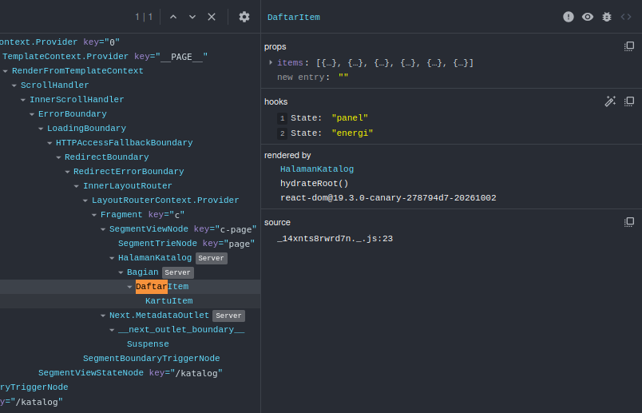
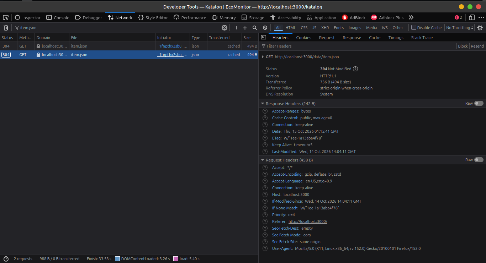
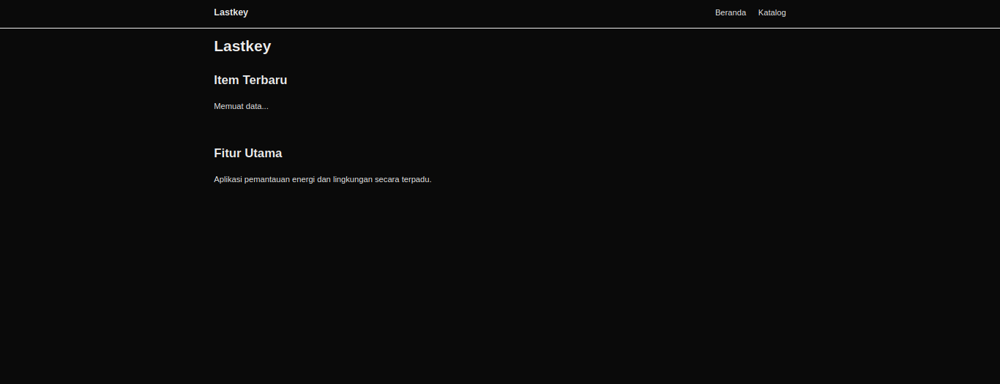
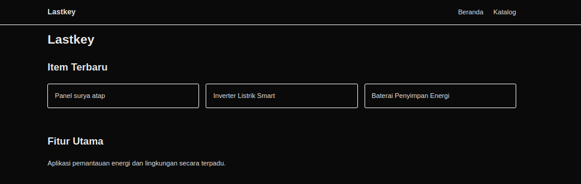
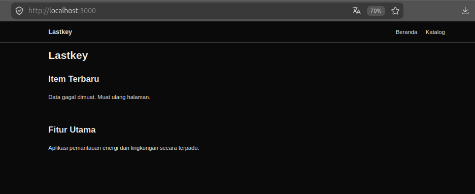
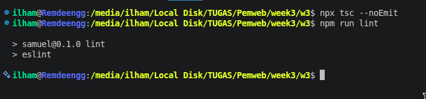

# Dokumen Teknis Modul 3 — TypeScript dan Komponen React

Nama/NIM : Moh Ilham Ramadhan Kurniawan / 105224014  
Repositori : https://github.com/ilhamrmdnk/Praktikum-Web-Ilham

## 1. Tipe Data Produk

Tipe data utama produk didefinisikan menggunakan `interface Item` pada `lib/tipe.ts`.

```ts
export type Kategori = "energi" | "lingkungan" | "kampus";

export interface Item {
  id: number;
  judul: string;
  kategori: Kategori;
  deskripsi: string;
  tersedia: boolean;
  gambar?: string;
}
```

`Kategori` menggunakan union type yang membatasi nilai kategori menjadi `"energi"`,
`"lingkungan"`, atau `"kampus"`. Pemilihan union type membuat nilai kategori
lebih terkontrol dan membantu TypeScript mendeteksi nilai yang tidak sesuai.

Properti `gambar` menggunakan tanda `?`, sehingga sifatnya opsional. Data `Item`
tetap dapat digunakan walaupun tidak memiliki nilai `gambar`.

## 2. Struktur Komponen

### Diagram pohon komponen

Struktur komponen akhir pada aplikasi adalah sebagai berikut.

```text
RootLayout (Server)
├── SiteHeader (Server)
│   └── tautan navigasi
├── HalamanBeranda (Server)
│   ├── Bagian (Server)
│   │   └── ItemTerbaru (Client)
│   │       └── KartuItem
│   └── Bagian (Server)
│       └── Fitur Utama
└── SiteFooter (Server)

HalamanKatalog (Server)
└── Bagian (Server)
    └── DaftarItem (Client)
        └── KartuItem
```

`DaftarItem` diberi `"use client"` karena membutuhkan state React untuk
pencarian dan filter. `ItemTerbaru` juga merupakan Client Component karena
menggunakan `useState`, `useEffect`, dan `fetch()` pada sisi client.

### Tabel komponen

| Komponen | Props dan tipe | Digunakan pada |
|---|---|---|
| `SiteHeader` | `namaProduk: string`, `tautan: Tautan[]` | `app/layout.tsx` |
| `SiteFooter` | `namaProduk: string` | `app/layout.tsx` |
| `Bagian` | `id: string`, `judul: string`, `children: React.ReactNode` | Halaman beranda dan katalog |
| `DaftarItem` | `items: Item[]` | `app/katalog/page.tsx` |
| `ItemTerbaru` | Tidak memiliki props | `app/page.tsx` |
| `KartuItem` | `item: Item` | Daftar item dan item terbaru |

Komponen menggunakan props bertipe agar data yang dikirim antar-komponen
memiliki bentuk yang jelas dan dapat diperiksa oleh TypeScript.

## 3. State dan Interaksi

### Bukti React Developer Tools



Screenshot menunjukkan:

- Props `items` berisi daftar item.
- State pertama bernilai `"panel"`.
- State kedua bernilai `"energi"`.

### Alur event hingga render ulang

Pada `DaftarItem`, terdapat dua state:

```tsx
const [kataKunci, setKataKunci] = useState("");
const [filter, setFilter] = useState<Filter>("semua");
```

Ketika pengguna mengetik pada input pencarian, event `onChange` menjalankan
`setKataKunci(e.target.value)`. React kemudian memperbarui state dan melakukan
render ulang komponen.

Untuk filter kategori, pengguna menekan tombol kategori. Event `onClick`
menjalankan `setFilter(k)`. State `filter` berubah dan komponen melakukan
render ulang.

Setelah state berubah, data `items` disaring menggunakan `kataKunci` dan
`filter`. Hasil penyaringan kemudian ditampilkan kembali sebagai daftar
`KartuItem`. Jika tidak ada hasil, komponen menampilkan pesan
`"Tidak ada item yang sesuai."`.

## 4. Pengambilan Data

Data item terbaru dimuat dari file JSON melalui Fetch API pada
`ItemTerbaru.tsx`.

```tsx
const res = await fetch("/data/item.json");

if (!res.ok) throw new Error(`HTTP ${res.status}`);

const data: Item[] = await res.json();
```

### Bukti Network



Hasil pengujian menunjukkan:

```text
GET http://localhost:3000/data/item.json
Status: 200 OK
Type: json
Initiator: fetch
```

### Pengujian kondisi

| Kondisi | Hasil pengujian |
|---|---|
| Memuat | Saat proses pengambilan data diberi jeda sementara, halaman menampilkan `Memuat data...`. |
| Berhasil | Saat `/data/item.json` tersedia, tiga item terbaru berhasil ditampilkan. Network menunjukkan `200 OK`. |
| Gagal | Saat URL JSON diubah sementara menjadi file yang tidak ada, halaman menampilkan `Data gagal dimuat. Muat ulang halaman.` Setelah pengujian, URL dikembalikan ke `/data/item.json`. |

#### Kondisi memuat



#### Kondisi berhasil



#### Kondisi gagal



## 5. Verifikasi

### TypeScript

Perintah yang digunakan:

```bash
npx tsc --noEmit
```

Hasil:

```text
Berhasil tanpa keluaran error.
```

### Lint

Perintah yang digunakan:

```bash
npm run lint
```

Hasil:

```text
Berhasil tanpa keluaran error.
```

Kedua pemeriksaan tersebut berhasil dijalankan pada project setelah fitur
Modul 3 selesai.



## 6. Kendala dan Penyelesaian

### 1. Request `item.json` menampilkan status 304

Pada pengujian awal, request `item.json` menampilkan `304 Not Modified`.
Hal tersebut terjadi karena browser menggunakan cache.

Penyelesaian dilakukan dengan mengaktifkan **Disable Cache** pada Network
DevTools dan melakukan reload. Setelah itu request `item.json` dapat terlihat
dengan status `200 OK` untuk kebutuhan evidence.

### 2. Kondisi loading terlalu cepat untuk ditangkap

Pada pengujian awal, data selesai dimuat terlalu cepat sehingga teks
`Memuat data...` sulit ditangkap.

Untuk pengujian sementara, diberikan delay 5 detik sebelum `response.json()`.
Setelah screenshot kondisi loading diperoleh, delay tersebut dihapus kembali
agar kode aplikasi kembali ke kondisi normal.

### 3. Pengujian failure

Untuk menguji kondisi gagal, URL fetch sementara diubah menjadi file JSON yang
tidak tersedia. Setelah pesan gagal berhasil ditampilkan, URL dikembalikan
menjadi `/data/item.json` dan aplikasi diverifikasi kembali.

## 7. Catatan Pemanfaatan AI

AI digunakan sebagai alat bantu selama pengerjaan dan dokumentasi Modul 3.

### Alat yang digunakan

- ChatGPT.

### Bagian yang dibantu

- Membantu memahami struktur dan kebutuhan Dokumen Teknis Modul 3.
- Membantu menjelaskan TypeScript, props, state, Client Component, dan Fetch API.
- Membantu menentukan langkah pengujian React Developer Tools dan Network.
- Membantu menyusun dokumentasi berdasarkan kode dan hasil pengujian project.

### Perintah utama yang diverifikasi

```bash
npx tsc --noEmit
npm run lint
```

### Cara verifikasi

Hasil bantuan AI tidak langsung dianggap sebagai hasil pengujian. Implementasi
diperiksa kembali pada project melalui browser, React Developer Tools,
Network DevTools, serta perintah TypeScript dan lint.

Pengujian fitur pencarian dan filter juga dilakukan langsung pada aplikasi,
termasuk pencarian `panel`, filter `energi`, dan kondisi ketika tidak ada item
yang sesuai.
