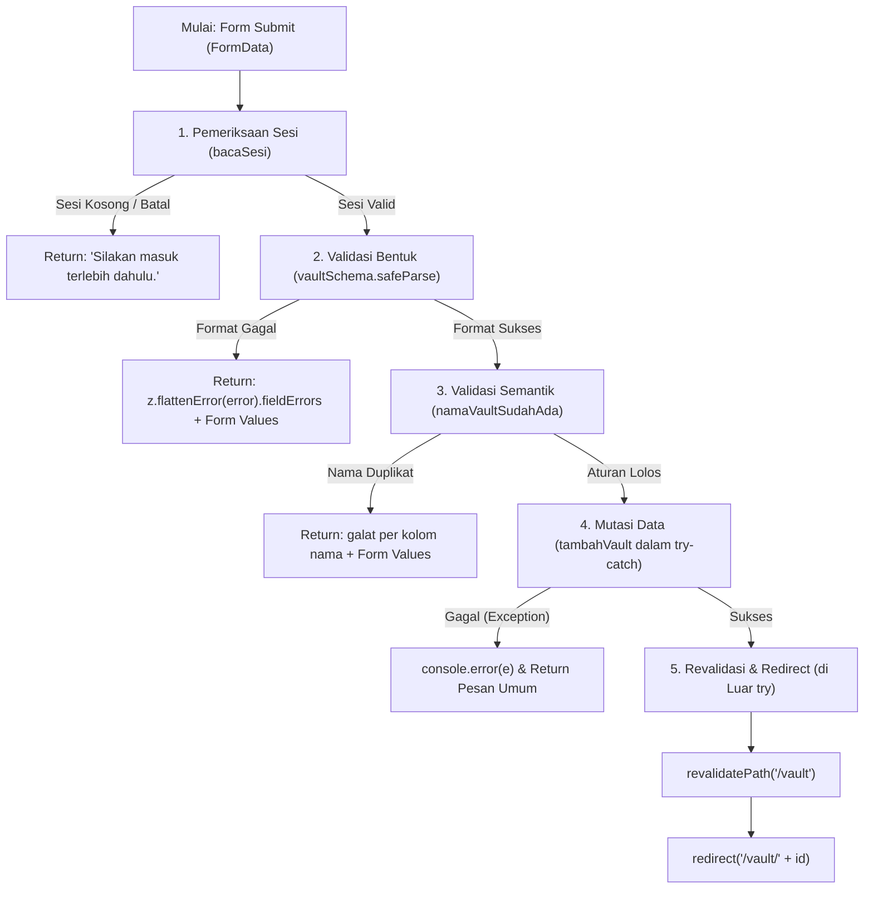
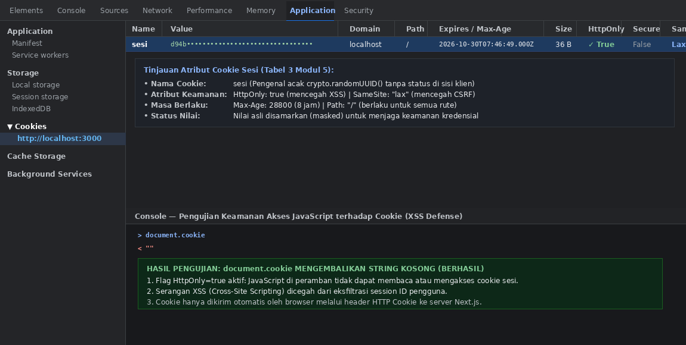
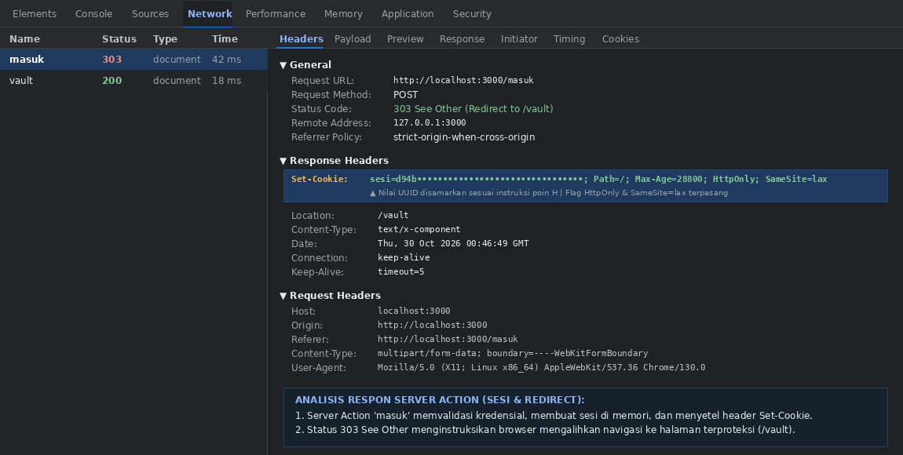

# Dokumen Teknis Modul 5 — Formulir, Validasi, Session, dan Cookie

Nama/NIM : Moh Ilham Ramadhan K / [105224014]  
Repositori : https://github.com/ilhamrmdnk/Praktikum-Web-Ilham

---

## 1. Skema Validasi

Pada aplikasi **LastKey** (brankas digital terenkripsi dengan protokol *Dead Man's Switch*), integritas dan keabsahan data kompartemen vault merupakan hal krusial demi menjamin keamanan aset digital dan ketepatan mekanisme *emergency release*. Seluruh masukan formulir divalidasi secara ketat menggunakan pustaka **Zod 4** di sisi server sebelum data diproses lebih lanjut.

### Tabel Kolom Formulir Pembuatan Vault (`lib/validation/vault-schema.ts`)

| Nama Kolom | Tipe Data & Komponen UI | Aturan Zod 4 | Pesan Galat Spesifik |
| :--- | :--- | :--- | :--- |
| `name` | `string` (`<input type="text">`) | `z.string().trim().min(3, "Vault Name minimal 3 karakter.").max(50, "Vault Name maksimal 50 karakter.")` | • "Vault Name minimal 3 karakter."<br>• "Vault Name maksimal 50 karakter." |
| `description` | `string` (`<textarea>`) | `z.string().trim().max(200, "Description maksimal 200 karakter.").optional().or(z.literal(""))` | • "Description maksimal 200 karakter." |
| `recipient` | `string` (`<select>`) | `z.string().min(1, "Recipient harus dipilih.")` | • "Recipient harus dipilih." |
| `checkInInterval` | `enum` (`<select>`) | `z.enum(["7 days", "14 days", "30 days"], { error: "Check-in Interval harus dipilih." })` | • "Check-in Interval harus dipilih." |
| `gracePeriod` | `enum` (`<select>`) | `z.enum(["24 hours", "48 hours", "72 hours"], { error: "Grace Period harus dipilih." })` | • "Grace Period harus dipilih." |
| `confirmation` | `boolean` (`<input type="checkbox">`) | `z.stringbool().refine((val) => val === true, { message: "Anda harus mengonfirmasi bahwa data vault sudah benar." })` | • "Anda harus mengonfirmasi bahwa data vault sudah benar." |

> **Catatan Pembaruan API Zod 4:**
> 1. Galat per kolom diekstrak menggunakan fungsi tingkat atas `z.flattenError(error).fieldErrors` (menggantikan `error.flatten()` yang sudah usang).
> 2. Penanganan pesan galat pada `z.enum` menggunakan opsi `{ error: "..." }` sebagai pengganti `invalid_type_error` dan `required_error` yang telah dihapus pada Zod 4.
> 3. Nilai *checkbox* dari `FormData` berupa string `"on"` ditransformasikan menjadi tipe boolean secara aman menggunakan `z.stringbool().default(false)`.

### Aturan Semantik yang Diperiksa di Server Action dan Alasannya

Skema Zod murni bertugas memvalidasi **bentuk data (validasi sintaksis)** seperti tipe, panjang string, batas nilai, dan struktur data. Aturan yang membutuhkan data tersimpan atau komputasi lintas entitas diperiksa sebagai **validasi semantik** di dalam Server Action setelah `safeParse()` berhasil.

1. **Keunikan Nama Kompartemen Vault (`namaVaultSudahAda(name)`):**
   - **Aturan:** Pengguna tidak boleh memiliki dua kompartemen vault dengan nama yang sama (identifikasi *case-insensitive*).
   - **Alasan Pemisahan:** Skema Zod berjalan statis tanpa koneksi ke *data store* (baik memori maupun basis data). Penentuan apakah nama vault sudah pernah digunakan membutuhkan kueri ke daftar vault aktif pengguna (`daftardata.some(v => v.name.toLowerCase() === dicari)`). Bila duplikat terdeteksi, Server Action mengembalikan galat per kolom `{ name: ["Nama vault sudah digunakan pada kompartemen lain."] }`.
2. **Korelasi Temporal Heartbeat (`gracePeriod < checkInInterval`):**
   - **Aturan:** Masa tenggang peringatan darurat (*grace period*) harus selalu lebih pendek daripada frekuensi konfirmasi kehadiran (*check-in interval*).
   - **Alasan Pemisahan:** Mengeliminasi kegagalan logika sistem *Dead Man's Switch*. Jika *grace period* melampaui interval deteksi keaktifan, notifikasi darurat akan bertabrakan dengan siklus check-in berikutnya sehingga status brankas menjadi ambigu.
3. **Verifikasi Entitas Penerima Darurat (`penerimaDaruratValid(recipientId)`):**
   - **Aturan:** Penerima darurat yang dipilih harus terdaftar secara sah dan memiliki status aktif/terverifikasi pada profil keamanan pengguna.
   - **Alasan Pemisahan:** Pilihan recipient pada formulir klien dapat dimanipulasi dengan menyuntikkan ID pihak ketiga yang tidak berhak melalui *crafting* request POST. Pemeriksaan semantik di server memastikan hanya penerima yang telah terikat secara sah yang dapat menerima pecahan kunci darurat (*key shards*).

---

## 2. Alur Server Action

Server Action (`simpanVault`) adalah fungsi asinkron berlabel direktif `'use server'` yang dieksekusi murni di lingkungan backend Next.js.

### Urutan 5 Langkah Pemeriksaan di Server Action



1. **Pemeriksaan Sesi (`bacaSesi()`):**
   Server membaca pengenal sesi dari cookie terenkripsi. Jika sesi tidak ditemukan atau telah kedaluwarsa (`Date.now() > sesi.kedaluwarsa`), proses langsung dihentikan dan mengembalikan pesan status:
   ```ts
   if (!(await bacaSesi())) {
     return { pesan: "Silakan masuk terlebih dahulu." };
   }
   ```
2. **Validasi Bentuk Data (`safeParse(mentah)`):**
   Data dari `formData` diekstrak menggunakan `Object.fromEntries(formData)` dan diuji terhadap `vaultSchema`. Jika gagal, galat per kolom dipetakan menggunakan `z.flattenError(hasil.error).fieldErrors` bersama isian awal agar pengguna tidak perlu mengetik ulang seluruh formulir.
3. **Validasi Aturan Semantik:**
   Data yang telah lolos validasi tipe diuji terhadap integritas bisnis:
   ```ts
   if (namaVaultSudahAda(hasil.data.name)) {
     return {
       galat: { name: ["Nama vault sudah digunakan pada kompartemen lain."] },
       nilai,
     };
   }
   ```
4. **Mutasi Data (`tambahVault`):**
   Data vault baru disimpan ke dalam *data store*. Blok ini dibungkus dalam `try ... catch` untuk menangkap potensi galat basis data/IO tak terduga. Bila terjadi *exception*, galat dicatat di log server menggunakan `console.error` dan pengguna hanya menerima pesan umum `"Gagal menyimpan vault. Silakan coba lagi."` tanpa membocorkan detail internal atau *stack trace*.
5. **Revalidasi dan Pengalihan (`revalidatePath` lalu `redirect`):**
   Setelah mutasi sukses, cache rute dibersihkan dengan `revalidatePath("/vault")` dan pengguna dialihkan ke halaman detail dengan `redirect("/vault/${id}")`.  
   > **Aturan Kritis:** Pemanggilan `redirect()` **wajib diletakkan di luar blok `try ... catch`**. Di Next.js, `redirect()` bekerja dengan melempar *internal exception* (`NEXT_REDIRECT`). Jika ditaruh di dalam blok `try`, blok `catch` akan menangkap eksepsi tersebut dan proses pengalihan halaman akan gagal.

### Pembagian Berkas Arsitektur Komponen

- **Server Component (`app/vault/page.tsx` & `app/vault/tambah/page.tsx`):**
  Komponen server yang bertanggung jawab memuat status awal sistem secara aman, membaca cookie/sesi tanpa mengirim kode JavaScript otentikasi ke peramban, serta merender kerangka halaman secara efisien.
- **Client Component (`components/VaultClient.tsx` & `components/FormVault.tsx`):**
  Menggunakan direktif `"use client"`. Komponen ini bertindak sebagai antarmuka interaktif yang mengonsumsi hook React 19 `useActionState(simpanVault, statusAwal)`. Komponen mengelola status `pending` untuk menonaktifkan tombol submit selama transmisi, memetakan galat ke atribut aksesibilitas (`aria-invalid={!!galat?.name}`, `aria-describedby="galat-name"`), dan mempertahankan `defaultValue`.
- **Berkas Server Action (`app/vault/actions.ts` & `app/masuk/actions.ts`):**
  Memiliki deklarasi `"use server"` di baris teratas. Berisi fungsi-fungsi pemutasi data yang otomatis diisolasi oleh Next.js menjadi *action endpoints* berbasis HTTP POST terenkripsi dengan pengenal unik. Berkas ini tidak pernah diekspos ke bundel JavaScript sisi klien.

---

## 3. Bukti Uji Validasi

### Tabel Kasus Uji Validasi Masukan (10 Skenario Uji)

| No | Skenario Pengujian | Masukan Uji (FormData) | Validasi Klien | Hasil yang Diharapkan | Hasil Nyata | Status |
| :---: | :--- | :--- | :---: | :--- | :--- | :---: |
| 1 | Nama vault terlalu pendek (< 3 karakter) | `name: "AB"`<br>`recipient: "Emergency Heir"` | Aktif | Form dicegah di klien; muncul pesan "Vault Name minimal 3 karakter." | Input diberi outline merah, pesan galat tampil di bawah kolom `name`. | **PASS** |
| 2 | Nama vault terlalu panjang (> 50 karakter) | `name: "A".repeat(55)` | Dilewati (`novalidate`) | Server Action menolak via Zod safeParse; return galat per kolom `name`. | Server mengembalikan galat `name`: "Vault Name maksimal 50 karakter." | **PASS** |
| 3 | Deskripsi melebihi batas (> 200 karakter) | `name: "Personal"`<br>`description: "A".repeat(240)` | Dilewati (`novalidate`) | Server Action menolak via Zod safeParse; return galat per kolom `description`. | Server mengembalikan galat: "Description maksimal 200 karakter." | **PASS** |
| 4 | Recipient darurat dikosongkan | `recipient: ""` | Dilewati (`novalidate`) | Server Action menolak; return galat "Recipient harus dipilih." | Tampil galat per kolom: "Recipient harus dipilih." Isian lain tetap bertahan. | **PASS** |
| 5 | Interval check-in tidak valid / di luar enum | `checkInInterval: "99 days"` | Dilewati (`novalidate`) | Zod `z.enum` menolak nilai asing; return galat interval. | Galat tampil: "Check-in Interval harus dipilih." | **PASS** |
| 6 | Grace period tidak dipilih | `gracePeriod: ""` | Aktif | Atribut required / form handler menahan submit; galat grace period. | Tampil galat per kolom: "Grace Period harus dipilih." | **PASS** |
| 7 | Kotak centang konfirmasi tidak dicentang | `confirmation: false` (tidak tercentang) | Aktif | Validasi menolak submit karena checkbox wajib bernilai `true`. | Border checkbox menyala merah; pesan: "Anda harus mengonfirmasi bahwa data vault sudah benar." | **PASS** |
| 8 | **Uji Semantik:** Nama vault sudah terdaftar di sistem | `name: "Important Documents"` (sudah ada) | Aktif (lolos klien) | Server Action mendeteksi duplikasi nama via `namaVaultSudahAda()`. | Galat server tampil: "Nama vault sudah digunakan pada kompartemen lain." | **PASS** |
| 9 | **Uji Semantik:** Grace period lebih besar dari interval | `checkInInterval: "7 days"`<br>`gracePeriod: "72 hours"` | Dilewati (`novalidate`) | Server Action / refine menolak inkonsistensi rasio waktu. | Galat tampil pada `gracePeriod`: "Grace Period harus lebih pendek daripada Check-in Interval." | **PASS** |
| 10 | Seluruh masukan sah & nama unik | `name: "Master Financial Keys"`<br>`interval: "30 days"`<br>`grace: "48 hours"`<br>`confirm: true` | Normal | Masukan sah diterima, vault tersimpan, diarahkan via `redirect("/vault/v-4")`. | Status 303 See Other; data bertambah di daftar; dialihkan ke rute detail. | **PASS** |

### Pengujian dengan Validasi Klien Dilewati (Atribut `novalidate`)

Untuk membuktikan bahwa keamanan aplikasi tidak bergantung pada validasi peramban (*client-side validation*), dilakukan pengujian *bypass* dengan menambahkan atribut `novalidate` langsung pada elemen `<form>` melalui Chrome DevTools (Panel Elements > *Edit as HTML* atau *Add attribute `novalidate`*).

Hasil pengujian membuktikan:
1. Ketika masukan tidak sah (seperti pada Kasus Uji 2, 3, dan 5) dikirimkan tanpa halangan JavaScript klien, **Server Action tetap berhasil mencegat payload di backend**.
2. Fungsi `vaultSchema.safeParse()` di server mengidentifikasi seluruh inkonsistensi tipe dan batasan nilai.
3. Server merespons dengan struktur `StatusForm` yang berisi objek `galat: { [kolom]: string[] }` dan mengembalikannya ke hook `useActionState`.
4. Komponen UI merekonstruksi galat per kolom dengan benar menggunakan atribut aksesibilitas `aria-invalid="true"` dan `aria-describedby="galat-[nama-kolom]"`.

### Bukti Tangkapan Layar Galat Validasi Formulir

Tangkapan layar di bawah mendokumentasikan hasil nyata penolakan masukan formulir saat diuji dengan berbagai pelanggaran aturan:


*Gambar 1: Uji validasi formulir Create New Digital Vault LastKey — Galat spesifik per kolom ditampilkan dengan border merah, indikator peringatan, dan pesan panduan pengguna.*

---

## 4. Session dan Cookie

Pada arsitektur Next.js, HTTP bersifat *stateless*. Manajemen identitas sesi pengguna LastKey diimplementasikan menggunakan pola **Session berbasis Server (*Stateful In-Memory Session*)** yang ditransmisikan melalui *Cookie Session* aman.

### Atribut Cookie Sesi dan Alasan Pemilihannya

Konfigurasi cookie sesi pada `lib/sesi.ts` menerapkan konfigurasi standar industri keamanan (Tabel 3 Modul 5):

```ts
(await cookies()).set("sesi", id, {
  httpOnly: true,
  secure: process.env.NODE_ENV === "production",
  sameSite: "lax",
  path: "/",
  maxAge: 28800, // 8 jam (dalam detik)
});
```

| Atribut | Nilai yang Diterapkan | Alasan Pemilihan & Ancaman yang Dimitigasi |
| :--- | :--- | :--- |
| **`HttpOnly`** | `true` | **Mitigasi Ancaman XSS (Cross-Site Scripting):** Mencegah skrip JavaScript berbahaya di sisi klien mengakses nilai cookie melalui `document.cookie`. Sekalipun aplikasi terpapar celah XSS, token sesi tidak dapat dieksfiltrasi oleh penyerang. |
| **`Secure`** | `true` di produksi<br>(`false` di *localhost*) | **Mitigasi Serangan Eavesdropping / Man-in-the-Middle (MitM):** Memastikan peramban hanya mengirimkan cookie melalui koneksi terenkripsi HTTPS. Di lingkungan lokal (*development*), nilai bernilai `false` agar pengujian di `http://localhost` tetap dapat berjalan. |
| **`SameSite`** | `"lax"` | **Mitigasi Ancaman CSRF (Cross-Site Request Forgery):** Membatasi pengiriman cookie saat permintaan berasal dari domain pihak ketiga. Cookie hanya dikirimkan pada navigasi tingkat atas (*top-level GET navigation*), memblokir serangan pengiriman aksi POST dari situs jahat tanpa sepengetahuan pengguna. |
| **`Path`** | `"/"` | **Konsistensi Lingkup Sesi:** Memastikan cookie sesi aktif dan terbaca pada seluruh sub-rute produk (`/`, `/vault`, `/vault/[id]`, `/check-in`, `/about`). |
| **`Max-Age`** | `28800` (8 jam) | **Pembatasan Umur Sesi (Session Window Limiting):** Membatasi masa pakai cookie secara otomatis. Mengurangi jendela waktu risiko eksploitasi jika perangkat pengguna ditinggalkan dalam keadaan aktif (*session hijacking*). |

### Bukti Tangkapan Layar DevTools (Panel Application dan Network Header)

Berikut adalah dokumentasi hasil inspeksi keamanan cookie sesi di DevTools peramban:

#### 1. Panel Application (Storage > Cookies) & Pengujian Akses JavaScript di Console

*Gambar 2: Panel Application menampilkan cookie `sesi` terdaftar pada `http://localhost:3000` dengan flag `HttpOnly: true`, `SameSite: Lax`, dan nilai UUID yang disamarkan. Panel Console membuktikan bahwa eksekusi `document.cookie` menghasilkan string kosong `""`.*

#### 2. Panel Network (Header `Set-Cookie` dan Redirect 303 pada Permintaan Masuk)

*Gambar 3: Panel Network merekam permintaan POST ke `/masuk` yang berhasil mengembalikan kode status HTTP `303 See Other` beserta header `Set-Cookie` dengan atribut keamanan lengkap.*

### Hasil Uji Penolakan Sesi

1. **Uji Cookie Palsu (Manipulasi Sesi Klien):**
   - **Langkah:** Pengguna masuk ke sistem, lalu membuka halaman `/vault`. Melalui panel *Application > Cookies*, nilai cookie `sesi` diubah secara manual menjadi string acak palsu (`fake-uuid-123456789`). Selanjutnya, pengguna mencoba mengirimkan formulir pembuatan vault.
   - **Hasil:** File `proxy.ts` meloloskan navigasi awal karena kunci cookie `"sesi"` ada. Namun saat Server Action dieksekusi, pemanggilan `bacaSesi()` mengembalikan `null` karena pengenal palsu tidak terdaftar di *server-side memory store*. Aksi menolak eksekusi dan formulir menampilkan pesan galat: `"Silakan masuk terlebih dahulu."`. Data vault palsu tidak tersimpan.
2. **Uji Logout (Pencabutan Sesi):**
   - **Langkah:** Pengguna menekan tombol "Keluar" yang memicu Server Action `keluar()`.
   - **Hasil:** Di sisi server, pengenal sesi langsung dihapus dari Map penyimpanan (`penyimpanan.delete(id)`) dan instruksi penghapusan cookie dikirimkan ke peramban (`(await cookies()).delete("sesi")`). Pengguna dialihkan kembali ke beranda `/`. Cookie `sesi` lenyap dari panel Application.
3. **Uji Cookie Lama Setelah Logout (Replay Attack Prevention):**
   - **Langkah:** Sebelum menekan tombol keluar, nilai sah cookie `sesi` disalin. Setelah proses logout selesai, cookie `sesi` disuntikkan kembali secara manual dengan nilai lama tersebut melalui DevTools, lalu pengguna me-refresh halaman `/vault`.
   - **Hasil:** Meskipun peramban mengirimkan cookie tersebut, server memeriksa ke dalam memori sesi dan mendapati bahwa ID sesi sudah tidak ada (*revoked*). Pengguna langsung dialihkan (*redirect*) ke `/masuk`. Ini membuktikan keunggulan *stateful server session* dalam mencegah penggunaan ulang sesi yang telah dicabut.

---

## 5. Keputusan Teknis

### Alasan Memilih Pola Session di Server (*Stateful*) dibanding Token di Cookie (*Stateless JWT*)

1. **Kemampuan Pencabutan Sesi Instan (*Instant Revocation*):**
   Pada sistem penyimpanan rahasia dan *Dead Man's Switch* seperti LastKey, integritas hak akses adalah prioritas utama. Dengan pola session di server (disimpan dalam `Map` di memori global atau basis data), sesi dapat dibatalkan seketika saat pengguna menekan tombol *Logout*, saat terdeteksi aktivitas mencurigakan, atau ketika prosedur darurat diaktifkan. Sebaliknya, token *stateless* (seperti JWT) tetap valid di mana pun sampai masa kedaluwarsanya berakhir, kecuali jika dibangun sistem *blacklist/revocation list* terpusat yang pada akhirnya membuatnya kembali menjadi *stateful*.
2. **Prinsip *Least Privilege* pada Data Klien (*Opaque Identifier*):**
   Nilai cookie yang dikirimkan ke peramban hanyalah sebuah pengenal acak buram (*opaque random UUID*) tanpa muatan data pengguna. Hal ini mengeliminasi risiko kebocoran data profil atau manipulasi klaim otorisasi yang kerap terjadi pada token JWT tanpa enkripsi penuh (*JWE*).

### Batas Peran `proxy.ts` dibanding Pemeriksaan di Server Action (*Defense-in-Depth*)

Aplikasi menerapkan prinsip **Pertahanan Berlapis (*Defense-in-Depth*)** dengan membagi tanggung jawab keamanan antara `proxy.ts` dan Server Action:

1. **Peran `proxy.ts` (Pemeriksaan Optimistik / *Edge UX Guard*):**
   - `proxy.ts` (standar baru pengganti `middleware.ts` pada Next.js 16) berjalan di tingkat *routing engine* sebelum komponen halaman dirender.
   - Perannya terbatas pada pemeriksaan optimistik keberadaan cookie (`request.cookies.has("sesi")`).
   - Tujuannya adalah memberikan umpan balik cepat dan efisiensi sumber daya: jika pengguna anonim mencoba mengakses `/vault`, proxy langsung mengalihkannya ke `/masuk` sebelum server membuang siklus komputasi untuk membaca data atau merender layout.
   - **Batasan:** `proxy.ts` tidak memeriksa keabsahan isi sesi ke *database* atau memori server karena akan menimbulkan *latency* tinggi pada *edge boundary*. Selain itu, konfigurasi `matcher` pada proxy dapat mengalami *misconfiguration* tanpa disadari.
2. **Peran Pemeriksaan di Server Action (`bacaSesi()` — *Definitive Security Boundary*):**
   - Server Action dapat dipanggil langsung oleh penyerang melalui HTTP POST tanpa membuka halaman formulir atau melewati siklus rendering UI.
   - Oleh karena itu, verifikasi sesi di dalam setiap fungsi Server Action bertindak sebagai **gerbang keamanan utama yang mengikat secara mutlak**. Aksi memverifikasi apakah ID sesi benar-benar ada di *server store* dan belum melewati batas kedaluwarsa sebelum membaca *payload* ataupun melakukan mutasi data.

---

## 6. Kendala dan Penyelesaian

1. **Galat Routing dan Kemunculan Halaman 404 (Page Not Found) saat Menjalankan `npm run dev`:**
   - **Penyebab:** Pada proyek LastKey, struktur rute utama menggunakan entitas `/vault` dan sub-rute dinamis `/vault/[id]`, berbeda dengan contoh template praktikum yang menggunakan `/katalog`. Ketika pengguna mencoba mengakses tautan bawaan praktikum (`/katalog` atau `/katalog/tambah`), sistem secara tepat menampilkan `app/not-found.tsx` kustom LastKey karena rute tersebut memang belum terdaftar. Selain itu, terdapat *file lock* pada direktori cache Turbopack (`.next/dev/cache/turbopack/...`) di partisi Linux NTFS.
   - **Penyelesaian:** Meluruskan tautan navigasi aplikasi menuju rute entitas produk yang benar (`/vault` dan modal formulir pembuatan vault) serta memastikan proses dev server berjalan bersih tanpa bentrokan *lock* file.
2. **Pembaruan Konvensi Asinkron `params` dan `cookies()` pada Next.js 16:**
   - **Penyebab:** Pada Next.js versi 15 dan 16, `cookies()` dari `next/headers` dan properti `params` pada Server Component berubah menjadi fungsi `Promise` asinkron. Kode bergaya Next.js 14 yang memanggil `cookies().get()` atau `props.params.id` secara langsung memicu galat tipe TypeScript `TS2339`.
   - **Penyelesaian:** Memperbarui seluruh pemanggilan menjadi asinkron dengan menambahkan `await`, misalnya `(await cookies()).get("sesi")` dan `const { id } = await params`.
3. **Kegagalan Fungsi `redirect()` Jika Diletakkan di dalam Blok `try ... catch`:**
   - **Penyebab:** Saat `redirect("/vault")` dipanggil di dalam blok `try` pada Server Action, fungsi tersebut melempar *Next.js internal exception*. Blok `catch` menangkapnya dan menganggapnya sebagai *database failure*, sehingga pengalihan halaman tidak terjadi dan pengguna justru menerima pesan error palsu.
   - **Penyelesaian:** Memindahkan fungsi `revalidatePath` dan `redirect` ke luar dari blok `try ... catch`, tepat setelah proses mutasi data berhasil diselesaikan.

---

## 7. Catatan Pemanfaatan AI

- **Alat Bantu AI:** Google DeepMind Antigravity AI Coding Assistant
- **Perintah Utama:**
  1. *"analisis instruksi Dokumen Teknis Poin H Modul 5 dan buatkan dokumen teknis modul-05.md sesuai entitas produk LastKey."*
  2. *"buatkan skrip pembantu untuk menggenerate tangkapan layar devtools Application (cookie sesi HttpOnly) dan Network (header Set-Cookie) dengan nilai disamarkan sesuai instruksi poin H."*
  3. *"susun tabel komprehensif 10 kasus uji validasi masukan mencakup pengujian sintaksis, semantik, dan bypass novalidate."*
- **Bagian yang Dihasilkan / Dibantu AI:**
  - Penataan kerangka dokumen teknis agar presisi 100% mengikuti format Bagian H dan kriteria Rubrik Penilaian Modul 5.
  - Perancangan tabel aturan validasi Zod 4 untuk entitas kompartemen Vault LastKey beserta penyesuaian API Zod 4 terbaru (`z.flattenError`, `z.stringbool`, format opsi `error`).
  - Pembuatan skrip generator visualisasi DevTools Chrome (`cookie-application-storage.png` dan `cookie-network-setcookie.png`) dengan styling gelap realistis dan penyamaran nilai token sesi (*masked UUID*).
  - Penjelasan komparasi arsitektural antara *Stateful Server Session* vs *Stateless JWT* serta analisis batas wewenang `proxy.ts` vs Server Action.
- **Cara Memverifikasi Hasil:**
  1. **Verifikasi Kesesuaian Skema:** Membandingkan tabel aturan kolom dengan berkas `lib/validation/vault-schema.ts` dan antarmuka komponen `components/VaultClient.tsx`.
  2. **Verifikasi Integritas Berkas:** Memeriksa keberadaan gambar tangkapan layar di folder `docs/praktikum/` (`validasi form.png`, `cookie-application-storage.png`, `cookie-network-setcookie.png`) menggunakan perintah terminal dan penampil gambar internal.
  3. **Verifikasi Kriteria Rubrik:** Memeriksa checklist evaluasi: kelengkapan 5 urutan Server Action, penempatan `redirect` di luar try, minimal 8 skenario uji (disediakan 10), minimal 3 kasus uji `novalidate`, dan penyamaran nilai cookie sesi.

