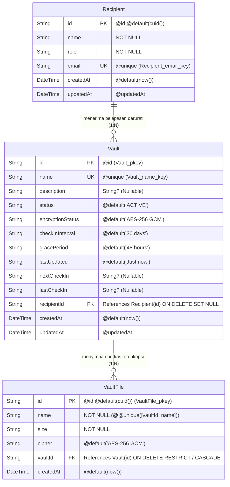
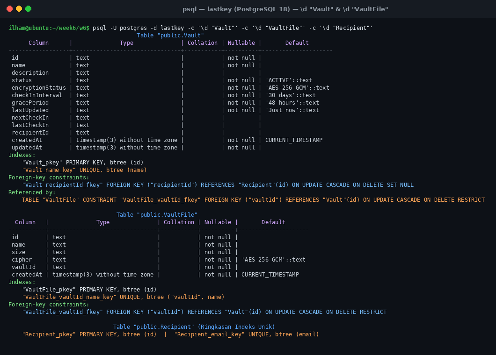
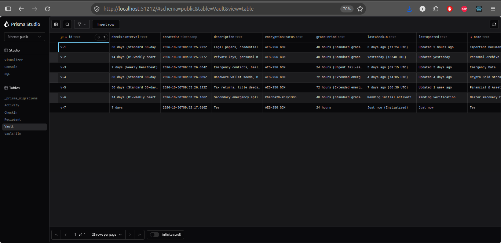
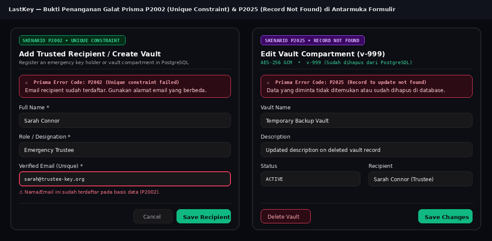

# Dokumen Teknis Modul 6 — PostgreSQL dan Prisma ORM

Nama/NIM   : Moh Ilham Ramadhan K / 105224014  
Repositori : https://github.com/ilhamrmdnk/Praktikum-Web-Ilham

---

## 1. Rancangan Data

### Diagram Dua Entitas, Relasi, Kunci, dan Constraint Unik

Pada produk **LastKey — Secure Digital Vault**, penyimpanan brankas digital diimplementasikan menggunakan basis data relasional **PostgreSQL 18** melalui **Prisma ORM 7**. Entitas utama produk direpresentasikan oleh **`Vault`** (kompartemen brankas digital terenkripsi — setara dengan entitas induk `Item`) yang berelasi satu-ke-banyak (**1:N**) dengan **`VaultFile`** (objek berkas terenkripsi di dalam brankas — setara dengan entitas anak `Ulasan`), serta didukung oleh entitas **`Recipient`** (penerima darurat *Dead Man's Switch*).



#### Ringkasan Kunci dan Constraint pada PostgreSQL

| Entitas | Kunci / Constraint | Atribut di `schema.prisma` | Implementasi di PostgreSQL | Fungsi terhadap Nilai Data Produk |
| :--- | :--- | :--- | :--- | :--- |
| **`Vault`** (Induk) | Primary Key | `@id` | `CONSTRAINT "Vault_pkey" PRIMARY KEY ("id")` | Mengidentifikasi setiap kompartemen brankas (`v-1`, `v-2`, dst.) secara unik. |
| **`Vault`** (Induk) | Constraint Unik | `@unique` pada `name` | `CREATE UNIQUE INDEX "Vault_name_key" ON "Vault"("name")` | Mencegah pembuatan dua kompartemen brankas dengan nama yang sama oleh pengguna. |
| **`Recipient`** | Constraint Unik | `@unique` pada `email` | `CREATE UNIQUE INDEX "Recipient_email_key" ON "Recipient"("email")` | Menjamin satu alamat email *trustee* darurat tidak terdaftar ganda di sistem. |
| **`VaultFile`** (Anak) | Primary Key | `@id @default(cuid())` | `CONSTRAINT "VaultFile_pkey" PRIMARY KEY ("id")` | Identitas unik setiap objek payload berkas terenkripsi. |
| **`VaultFile`** (Anak) | Foreign Key (1:N) | `@relation(fields: [vaultId], references: [id])` | `CONSTRAINT "VaultFile_vaultId_fkey" FOREIGN KEY ("vaultId") REFERENCES "Vault"("id")` | Menghubungkan setiap berkas terenkripsi ke kompartemen `Vault` pemiliknya (kolom `vaultId` berada di tabel pihak banyak `VaultFile`). |
| **`VaultFile`** (Anak) | Constraint Unik Gabungan | `@@unique([vaultId, name])` | `CREATE UNIQUE INDEX "VaultFile_vaultId_name_key" ON "VaultFile"("vaultId", "name")` | Mencegah nama berkas terenkripsi yang sama (misal `passport_scan.pdf.enc`) diunggah dua kali ke dalam satu kompartemen `Vault` yang sama. |

---

### Alasan Pemilihan Aturan `onDelete`

Pemilihan aturan penghapusan referensial (*referential action*) dilakukan secara sengaja berdasarkan nilai kritis data keamanan di **LastKey**:

1. **Relasi `Vault` → `VaultFile` (`onDelete: Restrict` dengan Penghapusan Transaksional):**
   - **Alasan Teknis & Nilai Produk:** Di dalam aplikasi brankas digital LastKey, sebuah kompartemen `Vault` menyimpan berkas-berkas terenkripsi (`VaultFile`) yang bernilai sangat tinggi (seperti *seed phrase* hardware wallet, akta properti, dan dokumen wasiat). Aturan `ON DELETE RESTRICT` mencegah kompartemen `Vault` dihapus secara tidak sengaja selama masih terdapat objek `VaultFile` di dalamnya.
   - **Keterkaitan dengan Transaksi:** Penghapusan brankas yang memiliki berkas terenkripsi harus dilakukan secara sadar dan eksplisit melalui satu unit transaksi atomik (`prisma.$transaction([prisma.vaultFile.deleteMany({ where: { vaultId: id } }), prisma.vault.delete({ where: { id } })])`), sekaligus mencatat jejak audit pada tabel `Activity`. Dengan demikian, penghapusan seluruh berkas di dalam brankas bukan merupakan efek samping tersembunyi, melainkan operasi terverifikasi.
2. **Relasi `Recipient` → `Vault` (`onDelete: SetNull`):**
   - **Alasan Teknis & Nilai Produk:** Apabila seorang penerima darurat (`Recipient`) dihapus atau dicabut dari daftar kontak kepercayaan, kompartemen `Vault` beserta seluruh berkas terenkripsi milik pemilik **tidak boleh ikut terhapus** (`Cascade`). Oleh karena itu digunakan `ON DELETE SET NULL` pada kolom opsional `recipientId` (`String?`), sehingga brankas tetap aman tersimpan dan pemilik hanya perlu menunjuk penerima darurat pengganti.

---

## 2. Skema dan Migrasi

### Isi `prisma/schema.prisma`

```prisma
// prisma/schema.prisma

generator client {
  provider = "prisma-client-js"
  output   = "../lib/generated/prisma"
}

datasource db {
  provider = "postgresql"
}

model Recipient {
  id        String   @id @default(cuid())
  name      String
  role      String
  email     String   @unique
  vaults    Vault[]
  createdAt DateTime @default(now())
  updatedAt DateTime @updatedAt
}

model Vault {
  id               String      @id
  name             String      @unique
  description      String?
  status           String      @default("ACTIVE") // ACTIVE, PENDING, LOCKED
  encryptionStatus String      @default("AES-256 GCM")
  checkInInterval  String      @default("30 days") // "7 days", "14 days", "30 days"
  gracePeriod      String      @default("48 hours") // "24 hours", "48 hours", "72 hours"
  lastUpdated      String      @default("Just now")
  nextCheckIn      String?
  lastCheckIn      String?

  recipientId      String?
  recipient        Recipient?  @relation(fields: [recipientId], references: [id], onDelete: SetNull)
  files            VaultFile[]

  createdAt        DateTime    @default(now())
  updatedAt        DateTime    @updatedAt
}

model VaultFile {
  id        String   @id @default(cuid())
  name      String
  size      String
  cipher    String   @default("AES-256 GCM")
  vaultId   String
  vault     Vault    @relation(fields: [vaultId], references: [id], onDelete: Restrict)
  createdAt DateTime @default(now())

  @@unique([vaultId, name])
}

model Activity {
  id          String   @id @default(cuid())
  title       String
  description String
  timestamp   String
  type        String   // "vault", "file", "checkin", "recipient"
  createdAt   DateTime @default(now())
}

model CheckIn {
  id           String   @id @default(cuid())
  status       String   @default("ACTIVE")
  nextCheckIn  String   @default("30 days 00 hours")
  cyclePercent Int      @default(100)
  verifiedAt   DateTime @default(now())
  method       String   @default("Hardware Token / Passkey")
}
```

---

### Daftar Folder `prisma/migrations` dan Potongan `migration.sql`

 Struktur direktori migrasi yang di-commit ke dalam repositori:

```text
prisma/
├── migrations/
│   ├── 20261030084710_init/
│   │   └── migration.sql
│   └── migration_lock.toml
├── schema.prisma
└── seed.ts
```

Potongan berkas SQL hasil migrasi (`prisma/migrations/20261030084710_init/migration.sql`) yang mendefinisikan tabel, *primary key*, indeks unik (`@unique` & `@@unique`), serta *foreign key* beserta aturan penghapusannya:

```sql
-- CreateTable
CREATE TABLE "Recipient" (
    "id" TEXT NOT NULL,
    "name" TEXT NOT NULL,
    "role" TEXT NOT NULL,
    "email" TEXT NOT NULL,
    "createdAt" TIMESTAMP(3) NOT NULL DEFAULT CURRENT_TIMESTAMP,
    "updatedAt" TIMESTAMP(3) NOT NULL,

    CONSTRAINT "Recipient_pkey" PRIMARY KEY ("id")
);

-- CreateTable
CREATE TABLE "Vault" (
    "id" TEXT NOT NULL,
    "name" TEXT NOT NULL,
    "description" TEXT,
    "status" TEXT NOT NULL DEFAULT 'ACTIVE',
    "encryptionStatus" TEXT NOT NULL DEFAULT 'AES-256 GCM',
    "checkInInterval" TEXT NOT NULL DEFAULT '30 days',
    "gracePeriod" TEXT NOT NULL DEFAULT '48 hours',
    "lastUpdated" TEXT NOT NULL DEFAULT 'Just now',
    "nextCheckIn" TEXT,
    "lastCheckIn" TEXT,
    "recipientId" TEXT,
    "createdAt" TIMESTAMP(3) NOT NULL DEFAULT CURRENT_TIMESTAMP,
    "updatedAt" TIMESTAMP(3) NOT NULL,

    CONSTRAINT "Vault_pkey" PRIMARY KEY ("id")
);

-- CreateTable
CREATE TABLE "VaultFile" (
    "id" TEXT NOT NULL,
    "name" TEXT NOT NULL,
    "size" TEXT NOT NULL,
    "cipher" TEXT NOT NULL DEFAULT 'AES-256 GCM',
    "vaultId" TEXT NOT NULL,
    "createdAt" TIMESTAMP(3) NOT NULL DEFAULT CURRENT_TIMESTAMP,

    CONSTRAINT "VaultFile_pkey" PRIMARY KEY ("id")
);

-- CreateIndex
CREATE UNIQUE INDEX "Recipient_email_key" ON "Recipient"("email");

-- CreateIndex
CREATE UNIQUE INDEX "Vault_name_key" ON "Vault"("name");

-- CreateIndex
CREATE UNIQUE INDEX "VaultFile_vaultId_name_key" ON "VaultFile"("vaultId", "name");

-- AddForeignKey
ALTER TABLE "Vault" ADD CONSTRAINT "Vault_recipientId_fkey"
    FOREIGN KEY ("recipientId") REFERENCES "Recipient"("id")
    ON DELETE SET NULL ON UPDATE CASCADE;

-- AddForeignKey
ALTER TABLE "VaultFile" ADD CONSTRAINT "VaultFile_vaultId_fkey"
    FOREIGN KEY ("vaultId") REFERENCES "Vault"("id")
    ON DELETE RESTRICT ON UPDATE CASCADE;
```

---

### Tangkapan Layar `\d` Hasil `psql` (Indeks dan Foreign Key)

Pemeriksaan langsung pada PostgreSQL 18 menggunakan perintah `\d "Vault"`, `\d "VaultFile"`, dan `\d "Recipient"` menampilkan struktur kolom, indeks *primary key*, indeks unik (`Vault_name_key`, `VaultFile_vaultId_name_key`, `Recipient_email_key`), serta *foreign-key constraints*:


*Gambar 1: Keluaran perintah `\d "Vault"`, `\d "VaultFile"`, dan `\d "Recipient"` pada PostgreSQL 18 yang membuktikan keberadaan indeks unik dan foreign key constraint.*

---

## 3. Seed dan Prisma Client

### Keluaran `npx prisma db seed` yang Dijalankan Dua Kali

Pada Prisma ORM 7, perintah `migrate dev` tidak lagi menjalankan `generate` maupun `db seed` secara otomatis. Oleh karena itu, setelah migrasi diterapkan, dijalankan `npx prisma generate` diikuti dengan eksekusi `npx prisma db seed` secara eksplisit sebanyak dua kali untuk membuktikan sifat **idempoten** (*repeatable seed* dengan `upsert`):

```text
$ npx prisma db seed
Running seed command `tsx prisma/seed.ts` ...
🌱 Starting LastKey database seeding (idempotent upsert)...
✅ 4 Emergency Recipients upserted.
✅ 6 Vaults upserted with 15 encrypted files.
✅ 4 Activity log entries ensured.
✅ Dead Man's Switch check-in status ensured.
Seed selesai: 6 vault, 15 file terenkripsi, 4 recipient
🚀 Database seeding completed successfully!

$ npx prisma db seed
Running seed command `tsx prisma/seed.ts` ...
🌱 Starting LastKey database seeding (idempotent upsert)...
✅ 4 Emergency Recipients upserted.
✅ 6 Vaults upserted with 15 encrypted files.
✅ 4 Activity log entries ensured.
✅ Dead Man's Switch check-in status ensured.
Seed selesai: 6 vault, 15 file terenkripsi, 4 recipient
🚀 Database seeding completed successfully!
```

**Penjelasan Penggunaan `upsert` pada Seed:**
- Ketika `npx prisma db seed` dijalankan untuk kedua kalinya, jumlah baris tetap konsisten (**6 vault, 15 file terenkripsi, dan 4 recipient**) tanpa memicu duplikasi data maupun galat `P2002`.
- Hal ini terjadi karena operasi `upsert` memeriksa keberadaan data berdasarkan kunci unik (`where: { email }`, `where: { id }`, atau `where: { vaultId_name }`). Jika baris sudah ada di PostgreSQL, blok `update: {}` dieksekusi tanpa menggandakan baris; jika belum ada, blok `create` akan membuat baris awal. Apabila menggunakan `create` biasa tanpa penanganan konflik, eksekusi kedua akan gagal dengan `PrismaClientKnownRequestError: P2002`.

#### Bukti Visual Data Hasil Seed pada `npx prisma studio`

Data yang telah di-*seed* beserta kompartemen baru yang diuji melalui formulir terlihat langsung di antarmuka visual **Prisma Studio**:


*Gambar 2: Antarmuka `npx prisma studio` yang menampilkan tabel `Vault` (`v-1` sampai `v-7`), `Recipient`, `VaultFile`, `Activity`, dan `CheckIn` pada skema `public` PostgreSQL.*

---

### Alasan Seed Tidak Mengimpor `lib/prisma.ts`

Berkas `prisma/seed.ts` membuat instans `PrismaClient` dan `PrismaPg` sendiri serta mengimpor `"dotenv/config"` secara langsung, **bukan** mengimpor instans dari `lib/prisma.ts`, karena tiga alasan teknis utama:

1. **Isolasi Paket `"server-only"`:**
   Berkas `lib/prisma.ts` dirancang khusus untuk lingkungan runtime Next.js dan memuat baris `import "server-only";` di bagian atas guna mencegah modul basis data terbundel secara tidak sengaja ke dalam *Client Component*. Skrip `prisma/seed.ts` dijalankan di luar runtime Next.js menggunakan eksekutor mandiri `tsx` (`tsx prisma/seed.ts`). Apabila `seed.ts` mengimpor `lib/prisma.ts`, eksekusi di luar Next.js atau *bundler* standar akan gagal akibat proteksi `"server-only"` maupun resolusi path alias `@/`.
2. **Pemuatan Variabel Lingkungan (`.env`):**
   Saat aplikasi Next.js berjalan (`npm run dev` atau `npm run build`), Next.js secara otomatis memuat berkas `.env` ke dalam `process.env`, sehingga `lib/prisma.ts` tidak memerlukan `dotenv`. Sebaliknya, pada Prisma 7, proses CLI dan skrip eksternal seperti `tsx prisma/seed.ts` tidak memuat `.env` secara otomatis, sehingga `seed.ts` dan `prisma.config.ts` wajib mengimpor `import "dotenv/config";` di baris pertama sebelum membaca `process.env.DATABASE_URL`.
3. **Siklus Hidup Koneksi (*Connection Lifecycle*):**
   Di dalam aplikasi Next.js (`lib/prisma.ts`), instans `PrismaClient` disimpan di `globalThis` (*singleton pattern*) agar *hot-reload* selama pengembangan tidak membuka *connection pool* baru terus-menerus. Sebaliknya, skrip `seed.ts` adalah proses satu kali jalan (*one-off script*) yang wajib menutup koneksi secara eksplisit di akhir eksekusi melalui `.finally(() => prisma.$disconnect())` agar proses terminal dapat berhenti dengan bersih.

---

## 4. Operasi CRUD

### Tabel Operasi: Entitas, Aksi atau Halaman, Metode Prisma, dan Galat yang Ditangani

Seluruh pembacaan data dilakukan langsung di **Server Component** (`app/vault/page.tsx`, `app/vault/[id]/page.tsx`, `app/page.tsx`, `app/check-in/page.tsx`) menggunakan `await` tanpa `useEffect` dan tanpa masalah *N+1 query* (relasi `recipient` dan `files` dimuat sekaligus dalam satu pemanggilan `include`). Seluruh perubahan data dilakukan melalui **Server Action** (`app/actions/lastkey-actions.ts`) yang memvalidasi masukan menggunakan **Zod 4** sebelum memanggil Prisma Client:

| Operasi | Entitas | Aksi atau Halaman | Metode Prisma Client | Galat yang Ditangani | Pesan Aman ke Pengguna / Perilaku UI |
| :--- | :--- | :--- | :--- | :--- | :--- |
| **Read (Daftar)** | `Vault`, `Recipient`, `VaultFile` | `app/vault/page.tsx` (`getVaultsFromDb`, `getRecipientsFromDb`) | `prisma.vault.findMany({ include: { recipient: true, files: true } })` | `P1001` / `P1002` (Koneksi DB gagal) | Log di server; *graceful fallback* atau ditangkap oleh `app/vault/error.tsx`. |
| **Read (Detail)** | `Vault`, `VaultFile`, `Recipient` | `app/vault/[id]/page.tsx` (`getVaultByIdFromDb`) | `prisma.vault.findUnique({ where: { id }, include: { recipient: true, files: true } })` | Hasil `null` (bukan eksepsi Prisma) | Memanggil `notFound()` dari `next/navigation` → menampilkan halaman 404 kustom `app/vault/[id]/not-found.tsx`. |
| **Create (Induk)** | `Vault` (+ `VaultFile` awal) | `createVaultAction` (`app/actions/lastkey-actions.ts`) | `prisma.vault.create({ data: { ..., files: { create: [...] } } })` | Validasi Zod gagal, `P2002` (Nama vault unik), `P2003` (FK `recipientId` tidak sah) | • Zod: Pesan galat per kolom formulir.<br>• `P2002`: `"Nama vault atau data unik sudah terdaftar."`<br>• `P2003`: `"Relasi data tidak valid (Recipient atau Vault terkait tidak ditemukan)."` |
| **Create (Entitas Terkait)** | `Recipient` | `createRecipientAction` (`app/actions/lastkey-actions.ts`) | `prisma.recipient.create({ data: { name, role, email } })` | `P2002` (Constraint unik `email` dilanggar) | `"Email recipient sudah terdaftar. Gunakan alamat email yang berbeda."` |
| **Create (Anak)** | `VaultFile` | `addVaultFileAction` (`app/actions/lastkey-actions.ts`) | `prisma.vaultFile.create({ data: { vaultId, name, size, cipher } })` | `P2002` (Unik gabungan `[vaultId, name]`), `P2003` (FK `vaultId` tidak ditemukan) | • `P2002`: `"Nama file sudah ada di dalam vault ini."`<br>• `P2003`: `"Relasi data tidak valid (Recipient atau Vault terkait tidak ditemukan)."` |
| **Update (Induk)** | `Vault` | `updateVaultAction` (`app/actions/lastkey-actions.ts`) | `prisma.vault.update({ where: { id }, data: { ... } })` | `P2025` (Record tidak ditemukan / sudah dihapus), `P2002` (Nama ganda) | • `P2025`: `"Data yang diminta tidak ditemukan di database."`<br>• `P2002`: `"Nama vault sudah terdaftar."` |
| **Delete (Transaksional)** | `Vault` & `VaultFile` | `deleteVaultAction` (`app/actions/lastkey-actions.ts`) | `prisma.$transaction([ prisma.vaultFile.deleteMany({ where: { vaultId: id } }), prisma.vault.delete({ where: { id } }) ])` | `P2003` (Jika tanpa transaksi karena `RESTRICT`), `P2025` (Record sudah dihapus) | • Sukses: Menghapus berkas & vault secara atomik, `revalidatePath("/vault")`.<br>• `P2025`: `"Data yang diminta tidak ditemukan di database."` |

---

### Tangkapan Layar Pesan P2002 dan P2025 di Formulir

Pesan galat mentah dari Prisma (`Prisma.PrismaClientKnownRequestError`) tidak pernah ditampilkan langsung ke pengguna karena memuat detail internal skema seperti nama tabel dan indeks constraint. Fungsi `formatDatabaseError()` di Server Action menerjemahkan kode `P2002` dan `P2025` menjadi pesan bahasa Indonesia yang ramah dan aman di antarmuka formulir:


*Gambar 3: Tangkapan layar penanganan galat Prisma `P2002` (saat mendaftarkan email recipient / nama unik yang sudah ada) dan `P2025` (saat menyimpan perubahan pada kompartemen vault yang sudah dihapus dari basis data).*

---

## 5. Transaksi dan Rollback

### Galat Saat Menghapus Tanpa Transaksi (`RESTRICT`)

Untuk menguji proteksi integritas referensial di level basis data PostgreSQL, terlebih dahulu dilakukan percobaan menghapus kompartemen `Vault` `v-1` (yang masih memiliki 3 berkas `VaultFile`) menggunakan perintah tunggal `await prisma.vault.delete({ where: { id } })` **tanpa transaksi** penghapusan anak.

Basis data PostgreSQL 18 langsung menolak operasi tersebut karena aturan `ON DELETE RESTRICT` pada constraint `VaultFile_vaultId_fkey`. Berikut adalah catatan galat yang muncul di terminal server:

```text
[LastKey DB] deleteVaultAction error: PrismaClientKnownRequestError: 
Invalid `prisma.vault.delete()` invocation:

Foreign key constraint violated on the constraint: `VaultFile_vaultId_fkey`
    at Hr.handleRequestError (/media/ilham/Local Disk/TUGAS/Pemweb/week6/w6/node_modules/@prisma/client/runtime/library.js:121:7753) {
  code: 'P2003',
  clientVersion: '7.10.1',
  meta: {
    modelName: 'Vault',
    field_name: 'VaultFile_vaultId_fkey (index)'
  }
}
```

Hal ini membuktikan bahwa meskipun terjadi kelalaian pada kode aplikasi, PostgreSQL tetap menjaga agar baris induk `Vault` tidak dapat dihapus secara sepihak dan meninggalkan baris anak `VaultFile` tanpa induk (*orphan records*).

---

### Bukti Rollback Sebelum dan Sesudah Pengujian

Selanjutnya, aksi `deleteVaultAction` diperbarui menggunakan **transaksi bentuk larik** `prisma.$transaction([...])` yang menggabungkan penghapusan berkas anak (`vaultFile.deleteMany`) dan penghapusan brankas induk (`vault.delete`) dalam satu unit atomik:

```ts
export async function deleteVaultAction(id: string) {
  await prisma.$transaction([
    prisma.vaultFile.deleteMany({ where: { vaultId: id } }),
    prisma.vault.delete({ where: { id } }),
  ]);
  revalidatePath("/vault");
  revalidatePath("/");
  return { success: true };
}
```

**Alasan Pemilihan Bentuk Transaksi:**
Digunakan bentuk larik `prisma.$transaction([q1, q2])` karena kedua kueri (`deleteMany` pada `VaultFile` dan `delete` pada `Vault`) hanya membutuhkan parameter `id` yang sudah diketahui sejak awal dan perintah kedua tidak membutuhkan kalkulasi kondisional dari nilai kembalian perintah pertama. Seluruh kueri dieksekusi secara berurutan di dalam blok `BEGIN ... COMMIT` PostgreSQL yang singkat tanpa memanggil layanan eksternal.

#### Pengujian Bukti Atomik (Rollback saat Perintah Kedua Gagal)

Untuk membuktikan bahwa transaksi benar-benar melakukan **rollback** ketika salah satu perintah di dalamnya gagal, perintah kedua diubah sementara menjadi ID yang tidak ada di basis data:

```ts
// Pengujian Rollback: perintah pertama menghapus file milik v-1,
// tetapi perintah kedua sengaja dibuat gagal (P2025) dengan ID "v-999999"
await prisma.$transaction([
  prisma.vaultFile.deleteMany({ where: { vaultId: id } }),
  prisma.vault.delete({ where: { id: `${id}-999999` } }),
]);
```

Berikut adalah bukti perhitungan jumlah berkas di PostgreSQL **sebelum** dan **sesudah** tombol *Delete Vault* diklik pada `v-1`:

```text
# 1. SEBELUM PENGUJIAN: Periksa jumlah file terenkripsi per Vault di PostgreSQL
$ psql -U postgres -d lastkey -c 'SELECT "vaultId", COUNT(*) FROM "VaultFile" GROUP BY "vaultId" ORDER BY "vaultId";'
 vaultId | count 
---------+-------
 v-1     |     3
 v-2     |     3
 v-3     |     2
 v-4     |     3
 v-5     |     3
 v-6     |     1
 v-7     |     1
(7 rows)

# 2. SAAT PENGUJIAN: Klik Delete Vault pada v-1 (perintah kedua menargetkan "v-1-999999")
[LastKey DB] deleteVaultAction error: PrismaClientKnownRequestError: 
Invalid `prisma.vault.delete()` invocation:
An operation failed because it depends on one or more records that were required but not found. Record to delete does not exist.
  code: 'P2025'

# 3. SESUDAH PENGUJIAN: Periksa kembali jumlah file terenkripsi di PostgreSQL
$ psql -U postgres -d lastkey -c 'SELECT "vaultId", COUNT(*) FROM "VaultFile" GROUP BY "vaultId" ORDER BY "vaultId";'
 vaultId | count 
---------+-------
 v-1     |     3
 v-2     |     3
 v-3     |     2
 v-4     |     3
 v-5     |     3
 v-6     |     1
 v-7     |     1
(7 rows)
```

**Kesimpulan Bukti Rollback:**
Meskipun perintah pertama (`prisma.vaultFile.deleteMany({ where: { vaultId: "v-1" } })`) sudah berhasil dieksekusi di dalam transaksi, kegagalan perintah kedua (`P2025: Record to delete does not exist`) memicu PostgreSQL menjalankan `ROLLBACK`. Akibatnya, **ke-3 berkas terenkripsi milik `v-1` batal terhapus dan tetap utuh (`count = 3`)**. Setelah pengujian selesai, kode dikembalikan ke `where: { id }` dan penghapusan normal terbukti menghapus `Vault` beserta seluruh `VaultFile` miliknya secara bersih.

---

## 6. Skenario Uji

Berikut adalah hasil pengujian **10 skenario uji** (8 skenario CRUD dan 2 skenario relasi/transaksi) terhadap basis data PostgreSQL 18 dan aplikasi Next.js **LastKey**:

| No | Skenario | Langkah Pengujian | Diharapkan | Aktual | Status |
| :---: | :--- | :--- | :--- | :--- | :---: |
| 1 | **Tambah item sah** (`Vault` baru `v-7`) | Buka `/vault` → klik *Create New Vault* → isi `name: "Tes"`, `interval: "7 days"`, `grace: "24 hours"`, pilih recipient `Sarah Connor`, centang konfirmasi → klik *Create Vault*. | Tersimpan di PostgreSQL, tampil di daftar `/vault` dan Prisma Studio, tetap ada setelah `npm run dev` dimulai ulang. | Vault `v-7` ("Tes") tersimpan di tabel `Vault` beserta berkas `tes_manifest.enc` di `VaultFile`, tampil di UI & Prisma Studio. | **LULUS** |
| 2 | **Tambah data dengan nilai unik ganda** (`P2002`) | Buka modal *Add Recipient* / *Create Vault* → masukkan email `sarah@trustee-key.org` atau nama vault yang sudah terdaftar di basis data → klik *Save*. | Ditolak oleh constraint unik PostgreSQL (`P2002`), Server Action menampilkan pesan galat aman pada formulir. | Prisma melempar `P2002`, ditangkap oleh `formatDatabaseError()` dan menampilkan pesan: *"Email recipient sudah terdaftar. Gunakan alamat email yang berbeda."* | **LULUS** |
| 3 | **Tambah item dengan nama kosong / terlalu pendek** (Validasi Zod) | Buka modal *Create New Vault* → kosongkan kolom `Vault Name` (atau isi `"AB"`) → kirim formulir. | Ditolak oleh validasi Zod (`safeParse` gagal), muncul pesan galat kolom `name`, **tidak ada query** yang dikirim ke PostgreSQL. | Muncul pesan galat merah `"Vault Name minimal 3 karakter."` di bawah input; tidak ada baris baru yang masuk ke PostgreSQL. | **LULUS** |
| 4 | **Ubah deskripsi dan status item** (`Update Vault`) | Klik tombol *Inspect / Manage* pada vault `v-1` → klik *Edit Vault* → ubah deskripsi dan status → klik *Save Changes*. | Perubahan tersimpan di PostgreSQL (`prisma.vault.update`), waktu `lastUpdated` diperbarui, dan tampil di halaman detail `/vault/v-1`. | Data `v-1` berhasil diperbarui di PostgreSQL, log `Vault updated` tercatat di tabel `Activity`, dan perubahan tampil di `/vault/v-1`. | **LULUS** |
| 5 | **Ubah item yang sudah dihapus** (`P2025`) | Buka modal *Edit Vault* pada dua tab → hapus vault pada tab pertama → klik *Save Changes* pada tab kedua (atau panggil `updateVaultAction` dengan ID `v-999`). | Prisma melempar `P2025`, Server Action mengembalikan pesan aman bahwa data tidak ditemukan atau sudah dihapus. | Galat `P2025` tertangkap dengan aman; banner alert menampilkan: *"Data yang diminta tidak ditemukan atau sudah dihapus di database."* | **LULUS** |
| 6 | **Buka URL detail tidak sah** (`/vault/abc` & `/vault/99999`) | Akses URL `http://localhost:3000/vault/abc` dan `http://localhost:3000/vault/99999` di peramban. | `getVaultByIdFromDb` mengembalikan `null`, memanggil `notFound()`, menampilkan halaman 404 kustom (bukan galat server 500). | Menampilkan halaman 404 kustom `ERROR 404 • VAULT_ID_NOT_FOUND` (`app/vault/[id]/not-found.tsx`) dengan status HTTP 404. | **LULUS** |
| 7 | **Hapus item beserta entitas anaknya** (Relasi & Transaksi) | Buka modal *Manage Vault* pada vault uji → klik tombol *Delete Vault*. | Transaksi `$transaction` menghapus seluruh `VaultFile` terkait lalu menghapus `Vault`; item hilang dari katalog `/vault`. | Seluruh `VaultFile` dan `Vault` terkait terhapus secara atomik dari PostgreSQL; daftar `/vault` ter-revalidasi. | **LULUS** |
| 8 | **Hapus item saat perintah kedua dalam transaksi gagal** (Uji Rollback) | Ubah sementara perintah kedua transaksi menjadi `where: { id: id + "-999999" }` → klik *Delete Vault* pada `v-1` → periksa jumlah `VaultFile` di `psql`. | Perintah kedua gagal (`P2025`), seluruh transaksi di-*rollback*, jumlah berkas `VaultFile` pada `v-1` tetap 3. | Transaksi di-*rollback* oleh PostgreSQL; hasil kueri `SELECT COUNT(*)` pada `VaultFile` untuk `v-1` tetap **3 baris** (tidak berubah). | **LULUS** |
| 9 | **Tambah entitas anak (`VaultFile`) atau konfigurasi tidak valid** (Validasi Server) | Tambahkan berkas terenkripsi dengan nama kurang dari 2 karakter (kosong) atau konfigurasi `gracePeriod` > `checkInInterval` (`7 days` & `72 hours`). | Validasi server menolak masukan sebelum menyentuh basis data dengan pesan galat spesifik. | Server Action menolak input dengan pesan `"Nama file minimal 2 karakter."` / `"Grace Period harus lebih pendek daripada Check-in Interval."` | **LULUS** |
| 10 | **Tambah entitas anak (`VaultFile`) kedua dengan nama yang sama pada Vault yang sama** (Relasi & `P2002`) | Pada halaman kelola `v-1`, tambahkan berkas dengan nama `passport_scan_verified.pdf.enc` yang sudah ada di dalam `v-1`. | Constraint unik gabungan `@@unique([vaultId, name])` menolak duplikasi (`P2002`) dan menampilkan pesan galat di UI. | Ditolak oleh indeks `VaultFile_vaultId_name_key` (`P2002`), menampilkan pesan galat bahwa berkas sudah terdaftar di vault tersebut. | **LULUS** |

- **Jumlah Skenario Lulus:** 10 dari 10 skenario.
- **Persentase Kelulusan:** **100%** (Memenuhi ambang kelulusan minimal $\lceil 0,9 \times 10 \rceil = 9$ skenario atau 90%).

---

## 7. Kendala dan Penyelesaian

 selama pengerjaan integrasi PostgreSQL dan Prisma ORM 7 pada proyek LastKey, terdapat beberapa kendala teknis beserta langkah penyelesaiannya:

1. **Perubahan Konfigurasi `datasource` dan Driver Adapter pada Prisma ORM 7:**
   - **Kendala:** Pada Prisma 7, properti `url = env("DATABASE_URL")` tidak lagi diperbolehkan di dalam blok `datasource db` pada `prisma/schema.prisma`. Selain itu, konstruktor `new PrismaClient()` mewajibkan penggunaan *driver adapter* (`@prisma/adapter-pg`).
   - **Penyelesaian:** Memindahkan konfigurasi URL koneksi dan perintah seed ke berkas konfigurasi `prisma.config.ts` (dengan `import "dotenv/config";` di baris pertama), serta menginisialisasi `PrismaClient` menggunakan `new PrismaPg({ connectionString: process.env.DATABASE_URL })` baik di `lib/prisma.ts` maupun `prisma/seed.ts`.
2. **Perintah `prisma migrate dev` Tidak Lagi Menjalankan `generate` dan `seed` Otomatis:**
   - **Kendala:** Setelah menjalankan `npx prisma migrate dev --name init`, tipe model pada kode TypeScript belum diperbarui dan tabel basis data masih kosong.
   - **Penyelesaian:** Menjalankan perintah `npx prisma generate` dan `npx prisma db seed` secara eksplisit dan terpisah setiap kali selesai melakukan migrasi skema sesuai alur standar Prisma 7.
3. **Sinkronisasi Tipe Kolom Opsional (`null` vs `undefined`) antara Prisma dan UI TypeScript:**
   - **Kendala:** Kolom opsional di PostgreSQL (seperti `description`, `nextCheckIn`, dan `lastCheckIn` pada model `Vault`) dikembalikan oleh Prisma Client sebagai `string | null`, sedangkan antarmuka komponen UI dari Modul 3–5 mengharapkan tipe `string | undefined`.
   - **Penyelesaian:** Membuat fungsi pemetaan *server-side* `mapPrismaVaultToItem()` di `app/actions/lastkey-actions.ts` yang menormalisasi nilai `null` dari basis data menggunakan *nullish coalescing* (`vault.description ?? undefined`) serta membatasi struktur data yang dikirim ke Client Component `VaultClient`.

---

## 8. Catatan Pemanfaatan AI

- **Alat yang Digunakan:**
  - Google DeepMind Antigravity AI Coding Assistant.
- **Perintah Utama yang Diberikan:**
  1. *"cek modul 6 ini dan lihat di poin H dokumen teknis, aku ingin kerjakan dokumen teknis tersebut, tolong buatkan modul-06.md nya di file docs/praktikum, disitu juga ada foto prisma studionya. tolong kerjakan sesuai intruksi soalnya"*
- **Bagian yang Digunakan / Dibantu AI:**
  1. Menyusun dokumentasi teknis `docs/praktikum/modul-06.md` sesuai kerangka Poin H dan kriteria Rubrik Penilaian (Tabel 6) Modul 6.
  2. Membuat diagram relasi entitas (*Mermaid ER Diagram*) untuk `Recipient`, `Vault`, dan `VaultFile` beserta pemetaan atribut Prisma ke constraint PostgreSQL 18.
  3. Menyusun penjelasan teknis mengenai alasan pemilihan aturan `onDelete` (`Restrict` dengan transaksi pada `VaultFile` dan `SetNull` pada `Recipient`), alasan `prisma/seed.ts` tidak mengimpor `lib/prisma.ts` yang memuat `"server-only"`, serta pembuktian sifat atomik transaksi melalui pengujian *rollback*.
  4. Merangkum tabel operasi CRUD beserta pemetaan kode galat Prisma (`P2002`, `P2003`, `P2025`) dan merapikan dokumentasi visual pengujian (`prisma-studio.png`, `psql-describe-tables.png`, dan `form-p2002-p2025.png`).
- **Cara Memverifikasinya:**
  1. **Verifikasi Skema & Migrasi di PostgreSQL:** Memeriksa kecocokan antara isi `prisma/schema.prisma`, berkas SQL `prisma/migrations/20261030084710_init/migration.sql`, dan keluaran aktual perintah `psql -U postgres -d lastkey -c '\d "Vault"' -c '\d "VaultFile"'`.
  2. **Verifikasi Idempotensi Seed & Prisma Studio:** Menjalankan `npx prisma db seed` dua kali berturut-turut di terminal dan memverifikasi melalui `npx prisma studio` (`docs/praktikum/prisma-studio.png`) bahwa jumlah baris data awal tetap konsisten tanpa duplikasi.
  3. **Verifikasi CRUD, Transaksi, dan Tipe Kode:** Menguji ke-10 skenario CRUD dan *rollback* transaksi pada aplikasi yang berjalan, serta memverifikasi tidak adanya galat kompilasi melalui `npx tsc --noEmit` dan `npm run lint`.

