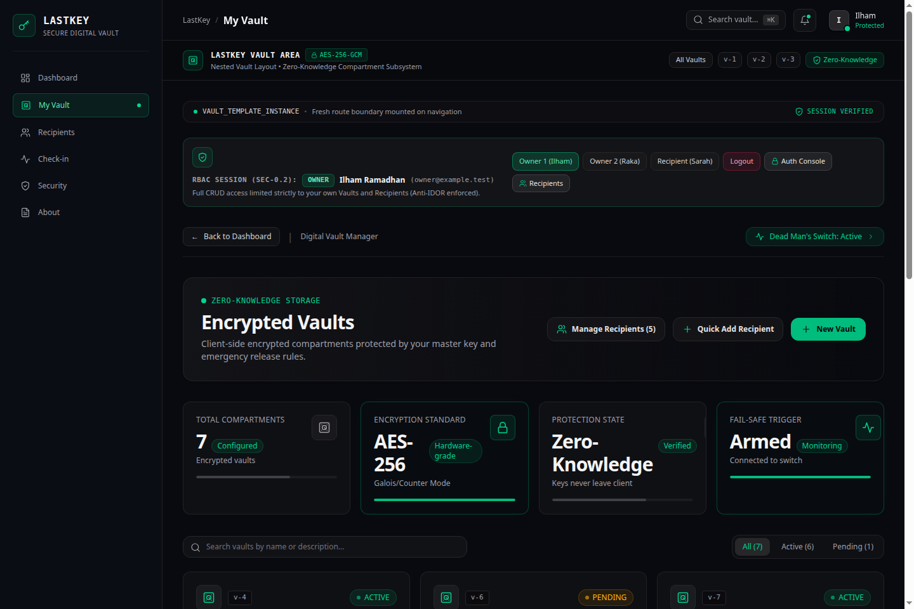
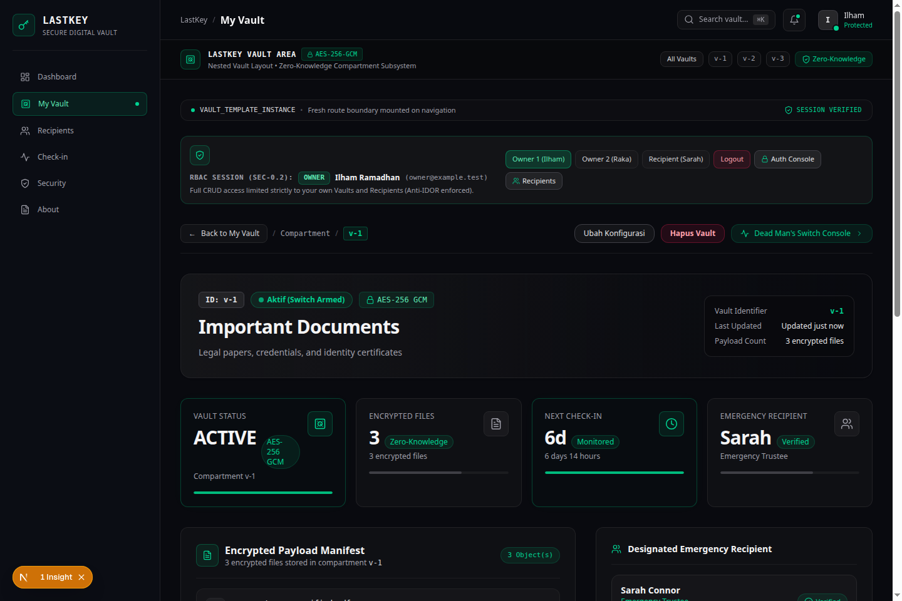
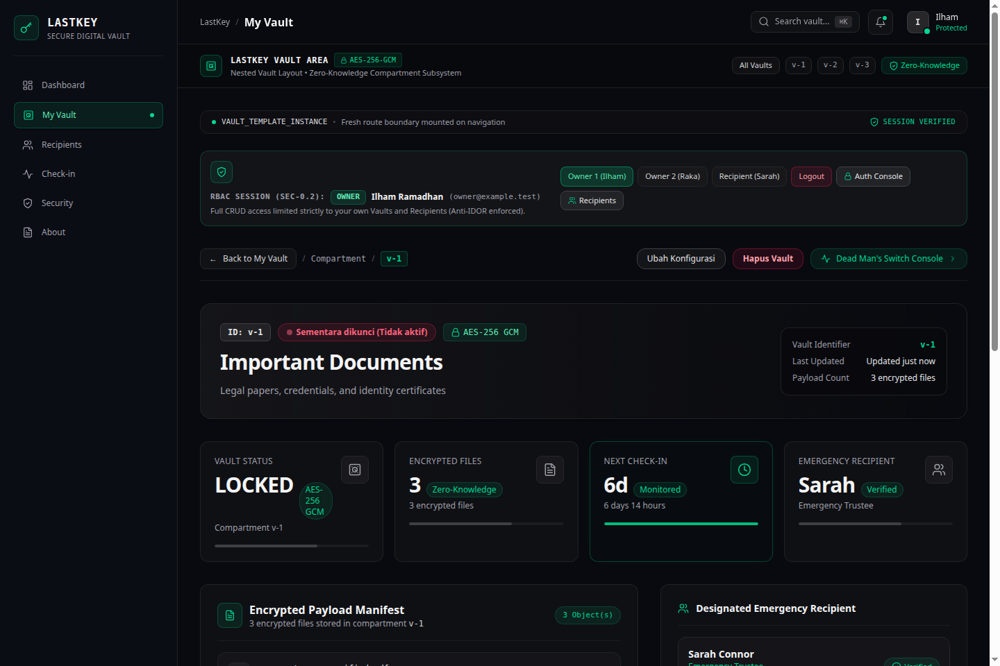
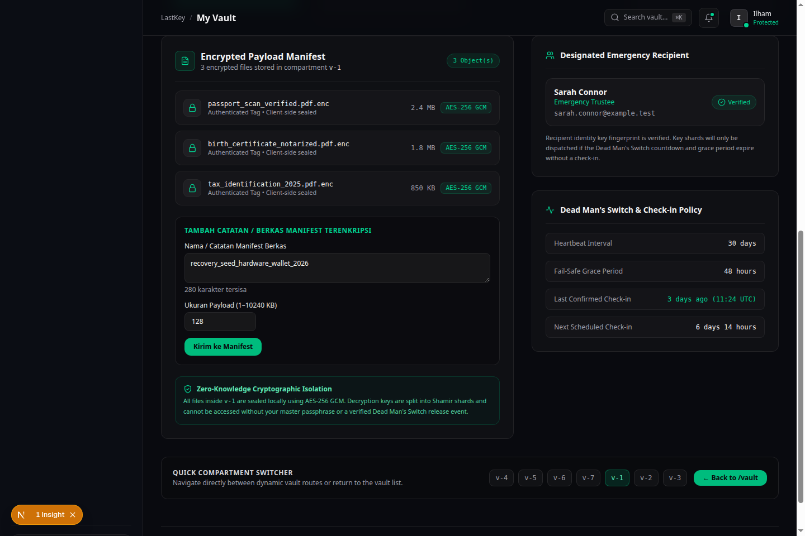
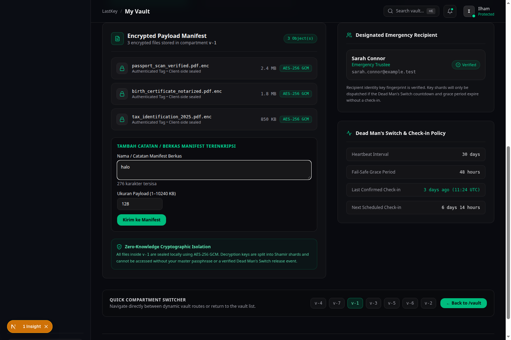

# Dokumen Teknis Modul 7 — Debugging dan Telaah Kode

Nama/NIM    : Moh Ilham Ramadhan K / 105224014  
Produk      : LastKey — Secure Digital Vault (Dead Man's Switch)  
Repositori  : https://github.com/ilhamrmdnk/105224014-LastKey  
Pull request: `https://github.com/ilhamrmdnk/105224014-LastKey/pull/[0000]` *(branch `praktikum/modul-07` → `main`; lengkapi nomor PR setelah melakukan `git push` dan membuka Pull Request di GitHub)*

---

## Pemetaan Entitas Produk LastKey terhadap Modul 7

Sesuai petunjuk Bagian D.1 Modul 7 (*"Bila produk Anda memakai nama lain, sesuaikan nama pada setiap langkah"*), berikut adalah pemetaan entitas dan berkas pada produk **LastKey** terhadap studi kasus modul:

| Komponen pada Modul | Implementasi pada Produk **LastKey** | Keterangan Peran dalam Produk |
| :--- | :--- | :--- |
| Entitas Induk (`Item`) | **`Vault`** (`prisma/schema.prisma`) | Kompartemen brankas digital terenkripsi AES-256-GCM dengan parameter *Dead Man's Switch*. Data *seed* memuat 7 kompartemen (`v-1` s.d. `v-3` memiliki berkas terenkripsi; `v-4` s.d. `v-6` tanpa berkas untuk skenario uji hapus). |
| Entitas Anak 1:N (`Ulasan`) | **`VaultFile`** (`prisma/schema.prisma`) | Objek berkas/catatan manifest terenkripsi di dalam kompartemen `Vault` (kolom *foreign key* `vaultId` merujuk `Vault.id` dengan aturan `ON DELETE RESTRICT`). |
| Entitas Relasi Tambahan | **`Recipient`** (`prisma/schema.prisma`) | Penerima darurat (*Emergency Trustee*) dengan indeks unik `email` (`@unique`) dan aturan `ON DELETE RESTRICT` terhadap `Vault`. |
| Rute Daftar & Detail | `/vault`, `/vault/[id]`, `/vault/[id]/edit` | Halaman daftar kompartemen (`app/vault/page.tsx`), detail kompartemen (`app/vault/[id]/page.tsx`), dan formulir ubah konfigurasi (`app/vault/[id]/edit/page.tsx`). |
| Skema Validasi Zod 4 | `lib/validation/vault-schema.ts` | Memuat `skemaEditVault` (`z.stringbool()` untuk field `aktif`) dan `skemaBerkasVault`. |
| Server Actions | `app/vault/[id]/actions.ts` | Memuat `ubahVault(id, _s, formData)`, `hapusVault(id)`, dan `tambahBerkasVault(vaultId, _s, formData)`. |
| Error Boundary Segmen | `app/vault/[id]/error.tsx` | *Client Component* penangkap galat tak terduga (seperti `P2025`) dengan prop stabil `retry()` pada Next.js 16.4.1 dan kode rujukan `error.digest`. |
| Komponen Klien Formulir | `components/FormEditVault.tsx` & `components/FormBerkasVault.tsx` | Formulir ubah status ketersediaan *switch* (`aktif`) dan formulir tambah catatan/berkas manifest dengan penghitung sisa 280 karakter. |

---

## 1. Lingkungan dan Konfigurasi Debugger

### 1.1 Spesifikasi Lingkungan dan Hash Commit Awal

| Komponen / Parameter | Versi / Nilai Aktual pada Lingkungan Kerja | Keterangan |
| :--- | :--- | :--- |
| **Sistem Operasi** | Linux (Ubuntu 24.04 LTS, x86_64) | Lingkungan pengembangan lokal |
| **Node.js** | `v20.20.2` *(acuan modul: 24 LTS)* | Mendukung penuh inspector V8 (`--inspect` pada `ws://127.0.0.1:9229`) |
| **Next.js** | `16.4.1` (App Router, Turbopack) | Mendukung penuh prop `retry` stabil pada `error.tsx` (stabil sejak v16.3.0) |
| **React** | `19.2.8` | Mendukung `useActionState` dan Server Actions |
| **Prisma ORM** | `7.10.1` (`@prisma/client` + `@prisma/adapter-pg`) | Konfigurasi `prisma7.config.ts` dengan driver adapter PostgreSQL |
| **PostgreSQL** | `16.15` (`Ubuntu 16.15-0ubuntu0.24.04.1`) | Basis data pengembangan `lastkey` pada `localhost:5432` dengan data sintetis |
| **Zod** | `4.6.7` | Mendukung API Zod 4 `z.stringbool()` dan `z.flattenError()` |
| **Peramban** | Google Chrome `157.0.8103.38` | Dilengkapi Chrome DevTools (Sources, Network, Console) & React Developer Tools |
| **Branch Kerja** | `praktikum/modul-07` | Dibuat dari branch `main` yang bersih |
| **Hash Commit Awal** | `4a043cb` (`4a043cb17190c490123ba84df10faa635072cde0`) | `test(security): cover session token expiration boundary` |
| **Commit Persiapan Debugger** | `6b6963f` | `chore(debug): siapkan launch.json, log query prisma, dan relasi restrict modul 7` |
| **Commit Usulan AI (Awal Galat)** | `403c51a` | `chore: terapkan usulan AI` |

### 1.2 Isi `.vscode/launch.json` dan Konfigurasi Log Prisma (`lib/prisma.ts`)

Berkas `.vscode/launch.json` di akar proyek dikonfigurasi mengikuti dokumentasi resmi Next.js 16 untuk tiga mode penelusuran (*server-side* melalui `node-terminal` dengan flag `--inspect`, *client-side* melalui Chrome, dan *full stack* menggunakan `debugWithChrome`):

```json
// .vscode/launch.json
{
  "version": "0.2.0",
  "configurations": [
    {
      "name": "Next.js: debug server-side",
      "type": "node-terminal",
      "request": "launch",
      "command": "npm run dev -- --inspect"
    },
    {
      "name": "Next.js: debug client-side",
      "type": "chrome",
      "request": "launch",
      "url": "http://localhost:3000"
    },
    {
      "name": "Next.js: debug full stack",
      "type": "node",
      "request": "launch",
      "program": "${workspaceFolder}/node_modules/next/dist/bin/next",
      "runtimeArgs": ["--inspect"],
      "skipFiles": ["<node_internals>/**"],
      "serverReadyAction": {
        "action": "debugWithChrome",
        "killOnServerStop": true,
        "pattern": "- Local:.+(https?://.+)",
        "uriFormat": "%s",
        "webRoot": "${workspaceFolder}"
      }
    }
  ]
}
```

Selanjutnya, opsi `log: ["query", "warn", "error"]` diaktifkan pada `lib/prisma.ts` saat mode `development` agar setiap query SQL yang dikirim Prisma ORM 7 ke PostgreSQL tercetak di terminal. Karena instans `PrismaClient` disimpan pada objek singleton `globalThis`, sesi server yang sedang berjalan dihentikan terlebih dahulu lalu dijalankan ulang melalui konfigurasi debug agar instans baru dengan opsi `query` terbentuk:

```ts
// lib/prisma.ts
import { PrismaClient } from "@prisma/client";
import { PrismaPg } from "@prisma/adapter-pg";

const globalForPrisma = globalThis as unknown as {
  prisma: PrismaClient | undefined;
};

function createPrismaClient(): PrismaClient {
  const connectionString = process.env.DATABASE_URL;
  const adapter = new PrismaPg({ connectionString });

  return new PrismaClient({
    adapter,
    // Modul 7: tampilkan setiap query SQL di terminal saat development.
    // Hapus "query" setelah praktikum agar log tidak terlalu ramai.
    log:
      process.env.NODE_ENV === "development"
        ? ["query", "warn", "error"]
        : ["error"],
  });
}

export const prisma = globalForPrisma.prisma ?? createPrismaClient();

if (process.env.NODE_ENV !== "production") {
  globalForPrisma.prisma = prisma;
}

export default prisma;
```

### 1.3 Bukti Sambungan Inspector Server dan Log Query Prisma pada Server Component

Saat konfigurasi **`Next.js: debug server-side`** dijalankan (`npm run dev -- --inspect`), proses Node.js membuka soket inspector pada port `9229` dan mencatat setiap query SQL ketika halaman Server Component `app/vault/page.tsx` (`http://localhost:3000/vault`) diakses:

```text
> ilham@0.2.0 dev
> next dev --inspect

Debugger listening on ws://127.0.0.1:9229/392634a3-e29f-409a-85b2-c0ca79823c91
For help, see: https://nodejs.org/en/docs/inspector
▲ Next.js 16.4.1 (Turbopack)
- Local:         http://localhost:3000
- Debugger port: 9229
- Environments: .env
✓ Ready in 3.0s

prisma:query SELECT "public"."Vault"."id", "public"."Vault"."name", "public"."Vault"."description", "public"."Vault"."status", "public"."Vault"."encryptionStatus", "public"."Vault"."checkInInterval", "public"."Vault"."gracePeriod", "public"."Vault"."lastUpdated", "public"."Vault"."nextCheckIn", "public"."Vault"."lastCheckIn", "public"."Vault"."recipientId", "public"."Vault"."ownerId", "public"."Vault"."createdAt", "public"."Vault"."updatedAt" FROM "public"."Vault" WHERE "public"."Vault"."ownerId" = $1 ORDER BY "public"."Vault"."createdAt" ASC OFFSET $2
prisma:query SELECT "public"."Recipient"."id", "public"."Recipient"."name", "public"."Recipient"."role", "public"."Recipient"."email", "public"."Recipient"."ownerId", "public"."Recipient"."createdAt", "public"."Recipient"."updatedAt" FROM "public"."Recipient" WHERE "public"."Recipient"."id" IN ($1,$2,$3,$4,$5,$6,$7) OFFSET $8
prisma:query SELECT "public"."VaultFile"."id", "public"."VaultFile"."name", "public"."VaultFile"."size", "public"."VaultFile"."cipher", "public"."VaultFile"."vaultId", "public"."VaultFile"."createdAt" FROM "public"."VaultFile" WHERE "public"."VaultFile"."vaultId" IN ($1,$2,$3,$4,$5,$6,$7) ORDER BY "public"."VaultFile"."createdAt" ASC OFFSET $8
 GET /vault 200 in 10.5s (next.js: 3.4s, application-code: 7.1s)
```

Pemeriksaan endpoint metadata inspector Node.js (`http://127.0.0.1:9229/json`) mengonfirmasi bahwa proses server Next.js aktif terhubung ke debugger dengan *source map* penuh:

```json
[
  {
    "description": "node.js instance",
    "id": "392634a3-e29f-409a-85b2-c0ca79823c91",
    "title": "/media/ilham/Local Disk/TUGAS/Pemweb/week7/node_modules/next/dist/server/lib/start-server.js",
    "type": "node",
    "webSocketDebuggerUrl": "ws://127.0.0.1:9229/392634a3-e29f-409a-85b2-c0ca79823c91"
  }
]
```


*Gambar 1: Halaman `/vault` (`app/vault/page.tsx`) yang memuat 7 kompartemen `Vault` milik `owner@example.test` dari PostgreSQL dengan pencatatan `prisma:query` aktif di terminal debug.*

> **Catatan Lampiran Panel VS Code:** Apabila diperlukan tangkapan layar antarmuka jendela penuh VS Code saat *breakpoint* berhenti di baris `const [session, vaults, recipients] = await Promise.all(...)` pada `app/vault/page.tsx:26` (menampilkan panel *Variables* berisi larik `vaults` dan *Call Stack*), lampirkan di bawah baris ini saat menjalankan `F5` di VS Code.

---

## 2. Daftar Galat

Seluruh empat galat utama pada kode usulan AI (`403c51a`) ditambah satu galat pengayaan pada *fixture* pengujian produk berhasil direproduksi, dipersempit lapisannya, dibuktikan akar penyebabnya, dan diperbaiki pada commit terpisah:

| No | Issue | Gejala | Lapisan | Akar penyebab | Commit perbaikan |
| :---: | :---: | :--- | :--- | :--- | :---: |
| 1 | `#11` | Mengubah kolom Ketersediaan Switch menjadi *"Tidak aktif (Sementara dikunci)"* pada `/vault/v-1/edit` menampilkan pesan *"Perubahan disimpan."*, tetapi kompartemen `v-1` di `/vault/v-1` tetap berstatus `ACTIVE` (*Aktif / Switch Armed*). | **Server** (Validasi Skema Zod di Server Action) | `z.coerce.boolean()` pada `skemaEditVault` (`lib/validation/vault-schema.ts`) menggunakan `Boolean(input)`, sehingga string tidak kosong `"false"` dari `FormData` dikonversi menjadi `true`. | `42be2cb` |
| 2 | `#12` | Mengklik tombol **Hapus Vault** pada kompartemen tanpa berkas (`v-5`) membuat halaman tertahan di `/vault/v-5` dan terminal mencetak `"Gagal menghapus"`, padahal baris `v-5` sudah hilang dari `/vault` dan PostgreSQL. | **Server** (Alur Kontrol Server Action) | `redirect("/vault")` dipanggil di dalam blok `try` pada `hapusVault` (`app/vault/[id]/actions.ts`), sehingga galat internal `NEXT_REDIRECT` tertangkap blok `catch` dan membatalkan perpindahan rute. | `b9deca1` |
| 3 | `#13` | Mengklik tombol **Hapus Vault** pada kompartemen yang memiliki berkas terenkripsi (`v-1`) gagal diam-diam tanpa pesan apa pun di antarmuka, sementara terminal hanya mencetak teks generik `"Gagal menghapus"`. | **Basis Data & Server** (Constraint FK PostgreSQL & Penanganan Eksepsi) | *Foreign key* `VaultFile_vaultId_fkey` (`ON DELETE RESTRICT`) menolak penghapusan `Vault` yang masih dirujuk `VaultFile` dengan kode `P2003`, lalu objek galat ditelan blok `catch`. | `b9deca1` |
| 4 | `#14` | Teks indikator `"280 karakter tersisa"` pada formulir tambah berkas manifest (`FormBerkasVault` di `/vault/[id]`) tidak pernah berkurang berapa pun karakter yang diketik pengguna. | **Peramban** (*State* & Efek *Client Component* React) | Nilai `sisa` disimpan pada `useState(280)` tersendiri dan dihitung di dalam `useEffect(() => { setSisa(280 - isi.length); }, [])` dengan larik dependensi kosong `[]`, sehingga hanya dieksekusi saat *mount* awal. | `21cecc2` |
| 5 | `#15` *(Pengayaan)* | Eksekusi *suite* pengujian akses `tests/access-control.test.ts` gagal di kait `before()` apabila dijalankan sesudah `npx prisma db seed`. | **Basis Data & Pengujian** (*Unique Constraint* PostgreSQL `P2002`) | `prisma.recipient.upsert({ where: { id: "ac-test-rec-sarah" } })` mencoba melakukan `INSERT` baris baru dengan email `"sarah.connor@example.test"` yang sudah terdaftar pada `rec-1` hasil *seed*, memicu `P2002` pada `Recipient_email_key`. | `9ba40cb` |

---

## 3. Catatan Penelusuran

### 3.1 Galat 1 (Issue `#11`) — Status Ketersediaan *"Tidak aktif (Sementara dikunci)"* Tidak Pernah Tersimpan

#### a. Langkah Reproduksi (Salinan Issue `#11`)

```markdown
## Status "Tidak aktif (Sementara dikunci)" pada Vault tidak tersimpan

**Lingkungan:** Node.js v20.20.2, Next.js 16.4.1, Zod 4.6.7, PostgreSQL 16.15, Chrome 157, branch `praktikum/modul-07` (commit awal `4a043cb`, kode usulan AI `403c51a`)
**Data awal:** kompartemen `Vault` `id = "v-1"` ("Important Documents") berstatus `ACTIVE` / Aktif (hasil `npx prisma db seed`), login sebagai `OWNER` (`owner@example.test`).

**Langkah reproduksi:**
1. Jalankan konfigurasi `"Next.js: debug server-side"`, lalu buka `http://localhost:3000/vault/v-1/edit`.
2. Pada kolom **Ketersediaan Switch (Status Aktif)**, ubah pilihan dari `"Aktif (Switch Armed)"` menjadi `"Tidak aktif (Sementara dikunci)"`.
3. Klik tombol **Simpan**, lalu buka halaman detail `http://localhost:3000/vault/v-1`.

**Hasil yang diharapkan:** lencana status pada kartu detail menampilkan `"Sementara dikunci (Tidak aktif)"` dan metrik `VAULT STATUS` bernilai `LOCKED`.
**Hasil aktual:** kompartemen `v-1` tetap menampilkan `"Aktif (Switch Armed)"` (`ACTIVE`), meskipun pesan `"Perubahan disimpan."` muncul di formulir.
**Frekuensi:** 5 dari 5 percobaan.
**Bukti:** payload permintaan POST `Next-Action` di panel Network, evaluasi ekspresi di Debug Console, log `prisma:query UPDATE`, dan tangkapan layar sebelum perbaikan.
```

#### b. Bukti Sebelum Perbaikan (Persempit Lapisan: Network Payload & Debug Console Server)

1. **Pemeriksaan Lapisan Jaringan (DevTools → Network):**  
   Permintaan `POST` ke `http://localhost:3000/vault/v-1/edit` memuat header `Next-Action: 70bf76c0fcbfa205455f447e2cc6af1d4726a0a963`. Pemeriksaan bagian *Payload* membuktikan bahwa peramban **sudah mengirim nilai string `"false"` yang benar** pada field `_1_aktif`:

   ```text
   POST http://localhost:3000/vault/v-1/edit
   Next-Action: 70bf76c0fcbfa205455f447e2cc6af1d4726a0a963

   ------WebKitFormBoundaryMishxhNAIuuULzWo
   Content-Disposition: form-data; name="_1_name"

   Important Documents
   ------WebKitFormBoundaryMishxhNAIuuULzWo
   Content-Disposition: form-data; name="_1_recipientId"

   rec-1
   ------WebKitFormBoundaryMishxhNAIuuULzWo
   Content-Disposition: form-data; name="_1_aktif"

   false
   ------WebKitFormBoundaryMishxhNAIuuULzWo--
   ```

2. **Pemeriksaan Lapisan Server (Breakpoint di `app/vault/[id]/actions.ts:38` & Debug Console):**  
   Karena payload jaringan sudah benar (`"false"`) dan log terminal mencatat `prisma:query UPDATE "public"."Vault" SET ... "status" = $6 ...`, batas kesalahan berada di **lapisan validasi server**. Evaluasi pada titik henti sebelum `prisma.vault.update` membuktikan konversi yang keliru:

   ```text
   > Object.fromEntries(formData)
   {
     name: 'Important Documents',
     description: 'Legal papers, credentials, and identity certificates',
     checkInInterval: '30 days',
     gracePeriod: '48 hours',
     recipientId: 'rec-1',
     aktif: 'false'
   }
   > hasil.data.aktif
   true
   > Boolean("false")
   true
   > Boolean("")
   false
   ```


*Gambar 2: Bukti sebelum perbaikan Galat 1 — setelah memilih "Tidak aktif (Sementara dikunci)" sebanyak 5 kali (`Last Updated: Updated just now`), kompartemen `v-1` tetap berstatus `Aktif (Switch Armed)` / `ACTIVE`.*

#### c. Akar Penyebab dan Perbaikan (Potongan Kode)

- **Akar Penyebab:** Elemen `<select name="aktif">` di HTML selalu mengirimkan nilai bertipe `string` (`"true"` atau `"false"`) di dalam `FormData`. Skema usulan AI memakai `z.coerce.boolean()`, yang secara internal menjalankan konstruktor JavaScript `Boolean(input)`. Dalam spesifikasi ECMAScript, setiap string yang tidak kosong—termasuk `"false"`—adalah nilai *truthy* (`Boolean("false") === true`), sehingga `hasil.data.aktif` selalu bernilai `true` dan `status` selalu disimpan sebagai `"ACTIVE"`.
- **Perbaikan (`lib/validation/vault-schema.ts`, commit `42be2cb`):** Mengganti `z.coerce.boolean()` dengan API bawaan Zod 4 **`z.stringbool()`**, yang secara eksplisit memetakan literal `"true"` menjadi `true`, `"false"` menjadi `false`, dan menolak string tidak sah lainnya sebagai galat validasi:

```ts
// lib/validation/vault-schema.ts (sebelum -> sesudah perbaikan pada skemaEditVault)
export const skemaEditVault = z
  .object({
    name: z.string().trim().min(3, "Vault Name minimal 3 karakter.").max(50, "Vault Name maksimal 50 karakter."),
    description: z.string().trim().max(200, "Description maksimal 200 karakter."),
    checkInInterval: z.enum(CHECK_IN_INTERVAL_VALUES),
    gracePeriod: z.enum(GRACE_PERIOD_VALUES),
    recipientId: z.string().trim().min(1, "Recipient harus dipilih."),
    // Sebelum (usulan AI): aktif: z.coerce.boolean(),
    // Sesudah perbaikan: "true" -> true, "false" -> false; nilai lain ditolak Zod 4
    aktif: z.stringbool(),
  })
  .refine((data) => isValidSwitchTiming(data.checkInInterval, data.gracePeriod), {
    message: SWITCH_TIMING_ERROR_MESSAGE,
    path: ["gracePeriod"],
  });
```

#### d. Bukti Sesudah Perbaikan

Langkah reproduksi pada Issue `#11` diulangi sebanyak **5 kali berturut-turut** pada `/vault/v-1/edit`:

```text
=== VERIFY GALAT 1 AFTER FIX (5x) ===
Attempt 1/5 -> DB status=LOCKED
Attempt 2/5 -> DB status=LOCKED
Attempt 3/5 -> DB status=LOCKED
Attempt 4/5 -> DB status=LOCKED
Attempt 5/5 -> DB status=LOCKED
Galat 1 fixed frequency: 5/5
Galat 1 UI shows Sementara dikunci (Tidak aktif): true
```


*Gambar 3: Bukti sesudah perbaikan Galat 1 — kompartemen `v-1` kini tersimpan sebagai `LOCKED` di PostgreSQL dan menampilkan lencana merah `"Sementara dikunci (Tidak aktif)"` pada 5 dari 5 percobaan.*

---

### 3.2 Galat 2 (Issue `#12`) — Hapus Vault Tanpa Berkas Membatalkan Navigasi `redirect()`

#### a. Langkah Reproduksi (Salinan Issue `#12`)

```markdown
## Hapus Vault tanpa berkas tidak berpindah ke /vault dan mencetak "Gagal menghapus"

**Lingkungan:** Node.js v20.20.2, Next.js 16.4.1, Prisma 7.10.1, Chrome 157, branch `praktikum/modul-07` (commit `403c51a`)
**Data awal:** kompartemen `Vault` `id = "v-5"` ("Financial & Asset Deeds") memiliki 0 baris `VaultFile` (hasil seed).

**Langkah reproduksi:**
1. Buka halaman detail `http://localhost:3000/vault/v-5` sebagai `OWNER`.
2. Klik tombol **Hapus Vault** di bilah aksi atas.
3. Amati URL di peramban, keluaran terminal server, lalu periksa daftar di `/vault`.

**Hasil yang diharapkan:** kompartemen `v-5` terhapus dari PostgreSQL dan peramban langsung diarahkan (redirect) ke `http://localhost:3000/vault` tanpa log galat.
**Hasil aktual:** URL peramban tetap tertahan di `http://localhost:3000/vault/v-5` dan terminal mencetak `"Gagal menghapus"`, padahal baris `v-5` sebenarnya sudah terhapus dari basis data.
**Frekuensi:** 5 dari 5 percobaan (pada kompartemen tanpa `VaultFile`).
**Bukti:** nilai `e.message` dan `e.digest` pada objek tangkapan `catch (e)` serta status baris di PostgreSQL.
```

#### b. Bukti Sebelum Perbaikan (Debug Console & Call Stack pada Blok `catch`)

Saat dipasang titik henti di dalam blok `catch (e)` pada `hapusVault` (`app/vault/[id]/actions.ts:68`) ketika menghapus `v-5`, pemeriksaan objek `e` menunjukkan bahwa eksepsi yang ditangkap bukanlah kegagalan basis data, melainkan sinyal internal milik fungsi `redirect()` Next.js:

```text
// Evaluasi objek e saat berhenti di blok catch (app/vault/[id]/actions.ts:68):
> e.message
"NEXT_REDIRECT"
> e.digest
"NEXT_REDIRECT;replace;/vault;307;"   // pada konteks form Server Action: "NEXT_REDIRECT;push;/vault;303;"

// Hasil verifikasi peramban & basis data sebelum perbaikan:
Galat 2 URL after Hapus v-5: http://localhost:3000/vault/v-5 | v-5 in DB: null
```

#### c. Akar Penyebab dan Perbaikan (Potongan Kode)

- **Akar Penyebab:** Di Next.js App Router, fungsi `redirect()` menghentikan eksekusi fungsi saat ini dengan cara **melempar objek galat khusus** yang memiliki `message: "NEXT_REDIRECT"` dan properti `digest` berawalan `"NEXT_REDIRECT;..."` agar ditangkap oleh *runtime* Next.js untuk mengirim respons pengalihan rute. Karena kode usulan AI meletakkan `redirect("/vault")` **di dalam blok `try`**, blok `catch (e)` milik aplikasi menangkap sinyal tersebut lebih dulu, menelannya, dan mencetak `"Gagal menghapus"` meskipun `prisma.vault.delete` pada baris sebelumnya sudah selesai dengan sukses.
- **Perbaikan (`app/vault/[id]/actions.ts`, commit `b9deca1`):** Memindahkan pemanggilan `revalidatePath("/vault")` dan `redirect("/vault")` ke **luar blok `try/catch`** (lihat potongan kode lengkap pada Subbagian 3.3.c di bawah).

#### d. Bukti Sesudah Perbaikan

Pengulangan langkah reproduksi pada kompartemen kosong `v-5` membuktikan penghapusan berhasil dan peramban langsung berpindah ke `/vault` tanpa mencetak log galat palsu:

```text
Galat 2 URL after Hapus v-5: http://localhost:3000/vault | v-5 in DB: null
```

---

### 3.3 Galat 3 (Issue `#13`) — Hapus Vault Berelasi `VaultFile` Gagal Diam-diam (`P2003` Ditelan `catch`)

#### a. Langkah Reproduksi (Salinan Issue `#13`)

```markdown
## Hapus Vault yang masih memiliki berkas VaultFile gagal diam-diam tanpa pesan

**Lingkungan:** Node.js v20.20.2, Next.js 16.4.1, Prisma 7.10.1, PostgreSQL 16.15, Chrome 157, branch `praktikum/modul-07` (commit `403c51a`)
**Data awal:** kompartemen `Vault` `id = "v-1"` atau `"v-2"` memiliki 3 baris berkas terenkripsi pada tabel `VaultFile` dengan constraint `ON DELETE RESTRICT`.

**Langkah reproduksi:**
1. Buka halaman detail `http://localhost:3000/vault/v-1` sebagai `OWNER`.
2. Klik tombol **Hapus Vault**.
3. Amati tampilan halaman dan baca keluaran di terminal server.

**Hasil yang diharapkan:** penghapusan mengikuti aturan produk secara konsisten (menghapus berkas anak dan kompartemen induk secara atomik dalam satu transaksi lalu berpindah ke `/vault`), serta tidak menelan galat tak terduga.
**Hasil aktual:** tidak ada pesan apa pun yang tampil ke pengguna, kompartemen `v-1` tidak terhapus, dan terminal menampilkan log `"Gagal menghapus"` yang sama persis dengan Issue #12.
**Frekuensi:** 5 dari 5 percobaan.
**Bukti:** potongan stack trace `PrismaClientKnownRequestError` dengan kode `P2003` di terminal.
```

#### b. Bukti Sebelum Perbaikan (Stack Trace Prisma `P2003` di Terminal)

Sebelum perbaikan, blok `catch` hanya mencetak `"Gagal menghapus"` tanpa menyertakan objek galat (pola **OWASP Top 10:2025 A10 — *Mishandling of Exceptional Conditions***). Setelah `console.log("Gagal menghapus")` diganti sementara dengan pencetakan objek galat, stack trace dari atas menunjuk langsung ke pemanggilan `prisma.vault.delete` pada `hapusVault` di `app/vault/[id]/actions.ts`:

```text
Gagal menghapus   <- log asli usulan AI: menelan objek galat sehingga identik dengan Issue #12

---- stack trace aktual Prisma 7.10.1 pada hapusVault("v-1") ----
PrismaClientKnownRequestError: 
Invalid `prisma.vault.delete()` invocation:

Foreign key constraint violated on the constraint: `VaultFile_vaultId_fkey`
    at vn.handleRequestError (.../node_modules/@prisma/client/src/runtime/RequestHandler.ts:238:13)
    ...
  code: 'P2003',
  meta: {
    modelName: 'Vault',
    driverAdapterError: DriverAdapterError: ForeignKeyConstraintViolation
  },
  clientVersion: '7.10.1'

 POST /vault/v-1 200 in 109ms (next.js: 10ms, application-code: 98ms)
  └─ ƒ hapusVault("v-1") in 47ms app/vault/[id]/actions.ts
```

#### c. Akar Penyebab dan Perbaikan (`app/vault/[id]/actions.ts` & `app/vault/[id]/error.tsx`)

- **Akar Penyebab:** Tabel `VaultFile` memiliki *foreign key* `vaultId` yang merujuk `Vault(id)` dengan aturan `ON DELETE RESTRICT`. Menghapus `Vault` secara langsung menggunakan `prisma.vault.delete` ketika masih ada baris `VaultFile` memicu penolakan integritas referensial PostgreSQL (`PrismaClientKnownRequestError` berkode **`P2003`**). Karena dibungkus oleh `catch (e) { console.log("Gagal menghapus"); }`, kegagalan tersebut ditelan bulat-bulat tanpa transaksi dan tanpa umpan balik ke antarmuka.
- **Perbaikan (`b9deca1`):**
  1. Menetapkan aturan produk bahwa penghapusan kompartemen `Vault` oleh pemilik (`OWNER`) menghapus seluruh objek `VaultFile` di dalamnya beserta induk `Vault` dalam **satu transaksi atomik** `prisma.$transaction([...])`, serta memindahkan `redirect("/vault")` ke luar `try/catch` dan menghapus blok `catch` penelan galat:

  ```ts
  // app/vault/[id]/actions.ts (perbaikan hapusVault)
  export async function hapusVault(id: string) {
    const session = await getCurrentSession();
    if (!session || session.role !== "OWNER") {
      throw new Error("Unauthorized: Hanya OWNER yang dapat menghapus Vault.");
    }

    // Keputusan produk: berkas terenkripsi (VaultFile) di dalam kompartemen ikut
    // terhapus bersama Vault induknya dalam satu transaksi atomik.
    // Keduanya berhasil atau keduanya dibatalkan (rollback).
    await prisma.$transaction([
      prisma.vaultFile.deleteMany({ where: { vaultId: id } }),
      prisma.vault.delete({ where: { id } }),
    ]);

    // Galat tak terduga (misalnya P2025) tidak ditelan:
    // dicatat di terminal server dan ditangkap oleh app/vault/[id]/error.tsx.
    revalidatePath("/vault");
    revalidatePath("/");
    redirect("/vault"); // di luar try/catch karena redirect melempar galat NEXT_REDIRECT
  }
  ```

  2. Membuat berkas *Error Boundary* segmen **`app/vault/[id]/error.tsx`** berupa *Client Component* yang menggunakan prop stabil **`retry`** pada Next.js 16.4.1 dan menampilkan `error.digest`:

  ```tsx
  // app/vault/[id]/error.tsx
  "use client"; // error boundary harus berupa Client Component

  import { useEffect } from "react";
  import Link from "next/link";
  import { AlertTriangleIcon } from "@/components/Icons";

  export default function GalatDetailVault({
    error,
    retry,
  }: {
    error: Error & { digest?: string };
    retry: () => void;
  }) {
    useEffect(() => {
      console.error(error);
    }, [error]);

    return (
      <div
        role="alert"
        className="mx-auto max-w-xl rounded-2xl border border-rose-500/30 bg-zinc-900/80 p-6 shadow-xl"
      >
        <div className="inline-flex items-center gap-2 rounded-full border border-rose-500/30 bg-rose-500/10 px-3 py-1 text-xs font-semibold text-rose-400">
          <AlertTriangleIcon className="h-3.5 w-3.5" />
          <span>VAULT SEGMENT ERROR BOUNDARY</span>
        </div>
        <h2 className="mt-4 text-xl font-bold text-zinc-100">
          Kompartemen Vault gagal diproses
        </h2>
        <p className="mt-2 font-mono text-xs text-zinc-400">
          Kode rujukan: {error.digest ?? "tidak ada"}
        </p>
        <div className="mt-5 flex flex-wrap items-center gap-3">
          <button
            type="button"
            onClick={() => retry()}
            className="rounded-xl bg-emerald-500 px-4 py-2 text-xs font-semibold text-zinc-950"
          >
            Coba lagi
          </button>
          <Link href="/vault" className="rounded-xl border border-zinc-700 px-4 py-2 text-xs text-zinc-200">
            Kembali ke /vault
          </Link>
        </div>
      </div>
    );
  }
  ```

#### d. Bukti Sesudah Perbaikan (Hapus Berelasi & Uji Dua Tab `P2025` pada `error.tsx`)

1. **Penghapusan kompartemen `v-2` yang memiliki 3 berkas `VaultFile`:** Transaksi berhasil menghapus ke-3 baris `VaultFile` dan baris `Vault` `v-2` secara atomik, lalu mengalihkan peramban ke `http://localhost:3000/vault`:
   ```text
   Galat 3 URL after Hapus v-2: http://localhost:3000/vault | v-2 in DB: null | v-2 files remaining: 0
   ```
2. **Pengujian Skenario Dua Tab (`P2025`):** Halaman `/vault/v-6` dibuka pada dua sesi/tab; setelah `v-6` dihapus pada tab pertama, penekanan tombol **Hapus Vault** pada tab kedua memicu `PrismaClientKnownRequestError` (`code: 'P2025': Record to delete does not exist`). Transaksi dibatalkan (*rollback*), stack trace lengkap tercatat di terminal server, dan `app/vault/[id]/error.tsx` menampilkan pesan ramah beserta kode rujukan `61201397`:

![Tampilan app/vault/[id]/error.tsx saat Menangkap Galat P2025](modul07-error-boundary-p2025.png)
*Gambar 4: Bukti `app/vault/[id]/error.tsx` menangkap galat `P2025` pada skenario penghapusan dua tab, menampilkan pesan ramah, `Kode rujukan: 61201397` (`error.digest`), dan tombol pemulihan `Coba lagi` (`retry()`).*

---

### 3.4 Galat 4 (Issue `#14`) — Penghitung Karakter `FormBerkasVault` Membeku di 280

#### a. Langkah Reproduksi (Salinan Issue `#14`)

```markdown
## Penghitung sisa karakter pada FormBerkasVault tetap 280 saat mengetik

**Lingkungan:** Node.js v20.20.2, Next.js 16.4.1, React 19.2.8, Chrome 157 + React Developer Tools, branch `praktikum/modul-07` (commit `403c51a`)
**Data awal:** halaman detail `http://localhost:3000/vault/v-1` menampilkan komponen `<FormBerkasVault vaultId="v-1" />`.

**Langkah reproduksi:**
1. Buka `http://localhost:3000/vault/v-1` sebagai `OWNER` dan gulir ke bagian **Tambah Catatan / Berkas Manifest Terenkripsi**.
2. Ketik teks `"recovery_seed_hardware_wallet_2026"` (34 karakter) atau `"halo"` (4 karakter) pada kolom textarea **Nama / Catatan Manifest Berkas**.
3. Amati teks penghitung karakter di bawah textarea serta periksa state `FormBerkasVault` di tab *Components* (React Developer Tools).

**Hasil yang diharapkan:** mengetik `"halo"` menampilkan `"276 karakter tersisa"` (atau `"246 karakter tersisa"` untuk 34 karakter) secara seketika setiap ketikan.
**Hasil aktual:** teks tetap menampilkan `"280 karakter tersisa"` berapa pun karakter yang diketik.
**Frekuensi:** 5 dari 5 percobaan.
**Bukti:** tangkapan layar formulir sebelum perbaikan, state pada React Developer Tools, dan keluaran linter aturan `react-hooks`.
```

#### b. Bukti Sebelum Perbaikan (DevTools, React Developer Tools, & Keluaran Linter)

1. **Penelusuran State & Breakpoint di Peramban:**  
   Pada React Developer Tools (tab *Components* → `FormBerkasVault`), state pertama (`isi`) terpantau berubah mengikuti setiap ketikan (`"recovery_seed_hardware_wallet_2026"`), sedangkan state kedua (`sisa`) tetap bernilai `280`. Pemasangan *breakpoint* di dalam `useEffect` melalui Chrome DevTools (tab *Sources* → `FormBerkasVault.tsx`) membuktikan bahwa baris `setSisa(280 - isi.length)` hanya tersentuh saat komponen pertama kali dipasang (*mount*) dan tidak pernah dipanggil ulang ketika event `onChange` memperbarui `isi`.
2. **Bukti Peringatan & Galat ESLint Sebelum Perbaikan (`npm run lint` pada commit `403c51a`):**

   ```text
   /media/ilham/Local Disk/TUGAS/Pemweb/week7/components/FormBerkasVault.tsx
     15:5  error    Error: Calling setState synchronously within an effect can trigger cascading renders ... (https://react.dev/learn/you-might-not-need-an-effect)  react-hooks/set-state-in-effect
     16:6  warning  React Hook useEffect has a missing dependency: 'isi.length'. Either include it or remove the dependency array.                                          react-hooks/exhaustive-deps
   ```


*Gambar 5: Bukti sebelum perbaikan Galat 4 — kolom textarea telah terisi `"recovery_seed_hardware_wallet_2026"` (34 karakter), tetapi indikator di bawahnya tetap membeku pada `"280 karakter tersisa"`.*

#### c. Akar Penyebab dan Perbaikan (Potongan Kode)

- **Akar Penyebab:** Kode usulan AI menduplikasi *derived state* ke dalam `const [sisa, setSisa] = useState(280)` dan menyinkronkannya lewat `useEffect(() => { setSisa(280 - isi.length); }, [])`. Larik dependensi kosong `[]` memerintahkan React untuk menjalankan efek hanya satu kali saat *mount* awal ketika `isi` masih `""` (`280 - 0 = 280`), sehingga perubahan `isi` berikutnya tidak pernah memperbarui `sisa`.
- **Perbaikan (`components/FormBerkasVault.tsx`, commit `21cecc2`):** Menghapus `useState(280)` dan `useEffect` seluruhnya, lalu menghitung `sisa` secara langsung sebagai nilai turunan saat *render*:

```tsx
// components/FormBerkasVault.tsx (bagian yang diperbaiki)
"use client";

import { useActionState, useState } from "react";
import { tambahBerkasVault, type StatusForm } from "@/app/vault/[id]/actions";

export default function FormBerkasVault({ vaultId }: { vaultId: string }) {
  const [state, formAction, pending] = useActionState<StatusForm, FormData>(
    tambahBerkasVault.bind(null, vaultId),
    {}
  );
  const [isi, setIsi] = useState("");
  const sisa = 280 - isi.length; // nilai turunan: dihitung langsung setiap render tanpa useEffect
  // ... JSX tetap sama, menampilkan <p>{sisa} karakter tersisa</p>
}
```

#### d. Bukti Sesudah Perbaikan

Setelah komponen diperbaiki dan server dimuat ulang, mengetik `"halo"` (4 karakter) langsung memperbarui teks menjadi **`"276 karakter tersisa"`** dalam satu kali *render* per ketikan, serta `npm run lint` dan `npx tsc --noEmit` selesai bersih tanpa satu pun galat maupun peringatan:


*Gambar 6: Bukti sesudah perbaikan Galat 4 — mengetik `"halo"` (4 karakter) langsung mengubah penghitung menjadi `"276 karakter tersisa"` pada 5 dari 5 percobaan.*

```text
$ npx tsc --noEmit
(selesai bersih dengan exit code 0)

$ npm run lint
> ilham@0.2.0 lint
> eslint
(selesai bersih dengan exit code 0, 0 error, 0 warning)
```

---

### 3.5 Pengayaan — Penelusuran `git bisect` dan Galat Kelima Produk (Issue `#15` — `P2002`)

#### a. Penelusuran Commit Penyebab Galat 1 dengan `git bisect`

Sesuai Tantangan Pengayaan Modul 7, `git bisect` dijalankan dengan menandai commit awal `4a043cb` sebagai `good` dan commit `403c51a` (`chore: terapkan usulan AI`) sebagai `bad`:

```text
$ git bisect start 403c51a 4a043cb
Bisecting: 0 revisions left to test after this (roughly 0 steps)
[6b6963feda59672ec7b549c1e89fa37493941a18] chore(debug): siapkan launch.json, log query prisma, dan relasi restrict modul 7

$ git bisect run bash -c '! grep -q "z.coerce.boolean()" lib/validation/vault-schema.ts'
running 'bash' '-c' ''\!' grep -q "z.coerce.boolean()" lib/validation/vault-schema.ts'
403c51a34ea74397a25e1cfdcc6db27b2ba8214b is the first bad commit
commit 403c51a34ea74397a25e1cfdcc6db27b2ba8214b
Author: ilhamrmdnk <ilhamrmdnk05@gmail.com>
Date:   Fri Nov 27 09:10:23 2026 +0700

    chore: terapkan usulan AI

bisect found first bad commit
$ git bisect reset
```

#### b. Galat 5 (Issue `#15`) — Pelanggaran Unique Constraint `P2002` pada Fixture Pengujian `Recipient`

- **Langkah Reproduksi:** Jalankan `npx prisma db seed` (membuat `Recipient` `id = "rec-1"` dengan email unik `"sarah.connor@example.test"`), lalu jalankan `npm test`.
- **Bukti Sebelum Perbaikan:** Stack trace Prisma menunjuk baris `tests/access-control.test.ts:51` dengan `PrismaClientKnownRequestError` (`Unique constraint failed on the constraint: Recipient_email_key`, **`code: 'P2002'`**).
- **Akar Penyebab & Perbaikan (`9ba40cb`):** `prisma.recipient.upsert({ where: { id: "ac-test-rec-sarah" }, create: { email: "sarah.connor@example.test", ... } })` memeriksa kunci primer `id`, bukan kolom `@unique` `email`. Ketika `rec-1` sudah ada di basis data dari hasil *seed*, `upsert` mengeksekusi cabang `create` dengan email yang sama dan melanggar `Recipient_email_key`. Perbaikan memeriksa keberadaan `Recipient` berdasarkan `where: { email: "sarah.connor@example.test" }` terlebih dahulu dan hanya menghapus *fixture* sementara apabila baris tersebut benar-benar dibuat oleh *test runner*.
- **Bukti Sesudah Perbaikan:** Eksekusi berulang `npm run db:seed && npm test` meluluskan **47 dari 47 pengujian otomatis** (`pass 47, fail 0`).

---

## 4. Keputusan Teknis

### 4.1 `z.stringbool()` Dibanding Alternatif Lain untuk Masukan Formulir HTML

Nilai elemen `<select>`, `<input type="radio">`, atau `<input type="hidden">` di dalam `FormData` selalu dikirim melalui jaringan HTTP sebagai `string`, bukan tipe primitif `boolean`. Berikut perbandingan `z.stringbool()` terhadap alternatif lain:

| Pendekatan Validasi | Perilaku untuk `"true"` | Perilaku untuk `"false"` | Perilaku untuk Nilai Liar (`"abc"` / `""`) | Penilaian Teknis |
| :--- | :---: | :---: | :---: | :--- |
| **`z.stringbool()` (Dipilih — Zod 4)** | `true` | `false` | **Ditolak** (`fieldErrors.aktif`) | **Paling tepat:** deklaratif, dirancang khusus oleh Zod 4 untuk protokol string lingkungan/formulir, menjaga tipe inferensi `boolean` (`z.infer`), dan menolak payload hasil manipulasi POST langsung. |
| `z.coerce.boolean()` | `true` | **`true` (Keliru!)** | `"abc"` → `true`; `""` → `false` | **Berbahaya untuk `FormData`:** memanggil `Boolean(val)` sehingga semua string tidak kosong dianggap `true`. |
| `z.enum(["true", "false"]).transform((v) => v === "true")` | `true` | `false` | **Ditolak** | **Valid tetapi lebih bertele-tele:** cara lama pada Zod 3 sebelum `z.stringbool()` hadir; membutuhkan fungsi transformasi manual di setiap skema. |
| `formData.get("aktif") === "true"` di luar Zod | `true` | `false` | **Lolos diam-diam sebagai `false`** | **Kurang aman:** melewati lapisan validasi skema terpusat; apabila nama field salah ketik (`undefined`) atau dikirim payload korup lewat `curl`, server diam-diam menganggap pengguna memilih `false` tanpa mengembalikan galat validasi. |

### 4.2 Aturan Hapus Entitas Induk Berelasi: Transaksi (`$transaction`), `onDelete: Cascade`, atau Tolak (`Restrict`)

Pada produk **LastKey**, terdapat dua relasi `1:N` dengan nilai bisnis yang berbeda, sehingga aturan penghapusan ditetapkan secara sadar berdasarkan konsekuensi domain keamanan:

1. **Relasi `Vault` → `VaultFile` (Dipilih: `onDelete: Restrict` di Skema + Penghapusan Eksplisit dalam `prisma.$transaction([...])`):**
   - **Mengapa bukan `onDelete: Cascade` murni di basis data?** Dengan `Cascade` di level skema, satu baris `prisma.vault.delete` yang terpanggil karena kekeliruan logika akan langsung memusnahkan seluruh berkas kriptografi (`VaultFile`) secara diam-diam di belakang layar tanpa jejak niat eksplisit di kode aplikasi.
   - **Mengapa bukan menolak penghapusan di UI?** Dalam alur kerja brankas digital, setiap kompartemen `Vault` yang dibuat otomatis memiliki minimal satu berkas manifest terenkripsi (`*_manifest.enc`). Memaksa pengguna menghapus satu per satu puluhan berkas manifest sebelum dapat menutup kompartemen miliknya sendiri akan menyulitkan pengguna tanpa menambah keamanan.
   - **Mengapa kombinasi `Restrict` + `$transaction([deleteMany, delete])` paling tepat?** Constraint `ON DELETE RESTRICT` di PostgreSQL tetap menjadi jaring pengaman terhadap penghapusan induk yang tidak disengaja, sedangkan di dalam `hapusVault` niat penghapusan dinyatakan secara eksplisit dan **atomik**: apabila langkah kedua (`prisma.vault.delete`) gagal (misalnya `P2025`), PostgreSQL melakukan `ROLLBACK` penuh sehingga berkas `VaultFile` tidak ikut hilang sebagian.
2. **Pembanding Kontras pada Relasi `Recipient` → `Vault` (Dipilih: Tolak Penghapusan dengan Pesan Aman):**
   - Berbeda dengan `VaultFile` yang merupakan isi internal brankas, seorang `Recipient` (*Emergency Trustee*) dapat ditugaskan ke beberapa `Vault` kritis. Menghapus `Recipient` secara berantai (`Cascade`) akan ikut menghapus brankas pemilik—bencana kehilangan data fatal. Oleh sebab itu, pada `deleteRecipientAction` (`lib/actions/recipient-actions.ts`), penghapusan `Recipient` yang masih terhubung ke `Vault` aktif **ditolak secara eksplisit** dengan pesan informatif agar pemilik mengalihkan penerima darurat terlebih dahulu.

### 4.3 Nilai Turunan Saat *Render* Dibanding `useEffect`

Menyimpan `sisa` (`280 - isi.length`) sebagai `const sisa = 280 - isi.length` saat *render* jauh lebih unggul dibanding menyimpannya di `useState` kedua yang diperbarui lewat `useEffect`:

1. **Satu Sumber Kebenaran (*Single Source of Truth*):** Ketika `isi` dan `sisa` disimpan di dua `useState` terpisah, keduanya berisiko tidak sinkron (seperti terbukti pada Galat 4 ketika dependensi `[]` membuat `sisa` tertinggal di `280`). Dengan menghitungnya saat *render*, secara matematis mustahil `sisa` berbeda dari `280 - isi.length`.
2. **Menghindari *Cascading Renders* (Efisiensi Kinerja):** Sekalipun larik dependensi diperbaiki menjadi `useEffect(() => setSisa(280 - isi.length), [isi])`, setiap satu ketikan pengguna akan memicu **dua siklus *render* beruntun**: *render* pertama dengan `isi` baru tetapi `sisa` lama, disusul eksekusi efek yang memanggil `setSisa` dan memaksa *render* kedua. Perhitungan aritmetika `280 - isi.length` berbiaya $\mathcal{O}(1)$ (nanodetik) sehingga cukup diselesaikan dalam **satu kali *render*** saja.
3. **Kapan `useEffect` tetap tepat digunakan?** Hanya ketika menyinkronkan komponen dengan **sistem eksternal di luar React**, misalnya mendaftarkan pendengar tombol `Escape` pada `window` di `VaultClient.tsx` atau mencatat objek galat ke konsol/layanan pemantauan di `app/vault/[id]/error.tsx`.

### 4.4 Kapan Galat Ditangani di Server Action dan Kapan Diteruskan ke `error.tsx`

Pemisahan tanggung jawab penanganan galat antara nilai kembalian Server Action dan *Error Boundary* `error.tsx` pada produk LastKey mengikuti prinsip berikut:

1. **Ditangani di dalam Server Action (dikembalikan sebagai objek state `{ pesan?, galat? }`):**  
   Digunakan untuk **galat yang dapat diperkirakan dan dapat diperbaiki langsung oleh pengguna pada formulir (*expected / validation errors*)**, meliputi:
   - Kegagalan validasi skema Zod 4 (`safeParse` → `z.flattenError(hasil.error).fieldErrors`) per kolom masukan;
   - Pelanggaran aturan bisnis atau keunikan data yang berkaitan dengan input formulir, seperti email `Recipient` yang sudah terdaftar (`P2002`) atau percobaan menghapus `Recipient` yang masih merujuk `Vault` aktif.  
   Dengan mengembalikan objek data biasa (bukan melempar `throw`), komponen formulir (`useActionState`) tetap terpasang di layar dan isian yang sudah diketik pengguna tidak hilang.
2. **Dipanggil di luar `try/catch` tanpa ditangkap aplikasi (`redirect()` dan `notFound()`):**  
   Keduanya bukan kegagalan aplikasi, melainkan mekanisme kontrol alur internal Next.js berbasis pelemparan sinyal khusus (`NEXT_REDIRECT` dan `NEXT_HTTP_ERROR_FALLBACK;404`). Menangkapnya di dalam `try/catch` akan merusak navigasi atau tampilan 404.
3. **Tidak ditelan di Server Action dan diteruskan ke `app/vault/[id]/error.tsx` (*unexpected / exceptional conditions*):**  
   Digunakan untuk **kegagalan sistem atau kondisi balapan di luar kendali formulir biasa**, seperti:
   - Penghapusan atau pemrosesan kompartemen yang ternyata sudah dihapus dari sesi/tab lain (`P2025`);
   - Putusnya koneksi ke server PostgreSQL (`P1001`/`P1002`) atau kegagalan integritas kunci enkripsi server (*fail-closed*).  
   Dengan membiarkan eksepsi terlempar keluar dari `hapusVault`, kita memperoleh dua jaminan keamanan sekaligus: (a) *stack trace* utuh tercatat di terminal/log server untuk kebutuhan audit & *debugging*, dan (b) pada *build* produksi, Next.js secara otomatis menyensor detail internal database dan hanya meneruskan hash **`error.digest`** ke `error.tsx` beserta tombol **`retry()`** untuk mencoba memuat ulang segmen secara aman.

---

## 5. Telaah Kode

> **Petunjuk Pengisian Bagian Kolaborasi GitHub:** Bagian ini menggunakan struktur wajib sesuai panduan Bagian E.5 dan Poin H.5 Modul 7. Setelah Anda melakukan `git push -u origin praktikum/modul-07`, membuka Pull Request ke `main`, dan bertukar telaah dengan pasangan praktikum Anda di GitHub, ganti bagian bertanda `[ISI ...]` di bawah ini dengan nama akun, URL PR aktual, dan komentar telaah nyata yang terjadi di repositori.

### 5.1 Deskripsi Pull Request Milik Sendiri (`praktikum/modul-07` → `main`)

- **Tautan PR Sendiri:** `https://github.com/ilhamrmdnk/105224014-LastKey/pull/[NOMOR_PR]`
- **Pasangan Penelaah (*Reviewer*):** `[ISI_NAMA_DAN_USERNAME_GITHUB_PASANGAN]`
- **Isi Deskripsi PR yang Digunakan (Menautkan Penutupan Otomatis Issue `#11`–`#15`):**

```markdown
## Ringkasan
Memperbaiki empat galat pada kode usulan AI untuk fitur ubah/hapus kompartemen Vault dan formulir berkas manifest (`FormBerkasVault`), serta satu galat benturan unique constraint pada fixture pengujian RBAC.

## Galat yang diperbaiki
- Closes #11: status aktif switch selalu true akibat `z.coerce.boolean()` memakai `Boolean()`
- Closes #12: `redirect()` tertelan blok `try/catch` pada `hapusVault`
- Closes #13: hapus kompartemen Vault berelasi `VaultFile` gagal tanpa pesan (`P2003` ditelan)
- Closes #14: penghitung sisa karakter pada `FormBerkasVault` dihitung saat render tanpa `useEffect`
- Closes #15: cegah benturan `P2002` (`Recipient_email_key`) pada fixture pengujian setelah seed

## Cara menguji
1. Jalankan `npx prisma db seed`, lalu `npm run dev`.
2. Ikuti langkah reproduksi pada tiap issue (`#11` s.d. `#15`); seluruh hasil aktual harus sesuai dengan bagian "Hasil yang diharapkan".
3. Jalankan `npm run lint`, `npx tsc --noEmit`, dan `npm test`.

## Bukti
Tangkapan layar, payload Network, stack trace, hasil `git bisect`, dan log query tersedia di `docs/praktikum/modul-07.md`.

## Pemanfaatan AI
Kode simulasi awal dan penyusunan dokumentasi dibantu asisten AI; seluruh temuan galat, perubahan, dan verifikasi dicatat di `AI_LOG.md`.
```

### 5.2 Telaah yang Diberikan pada Pull Request Pasangan

- **Repositori & Tautan PR Pasangan:** `https://github.com/[USERNAME_PASANGAN]/[REPO_PASANGAN]/pull/[NOMOR_PR_PASANGAN]`
- **Keputusan Telaah (*Review Decision*):** `[Approve / Request changes]` — *Alasan singkat: `[Contoh: Seluruh akar penyebab keempat galat sudah diperbaiki dengan tepat dan bukti reproduksi lengkap; terdapat satu saran perkuatan validasi batas angka dan satu saran gaya penamaan minor.]`*
- **Daftar Komentar Baris yang Diberikan (Format: `baris | kategori | masalah | perbaikan`):**

1. **Komentar 1 (Wajib — Memuat Blok `suggestion`):**
   ```markdown
   L[NOMOR_BARIS] | Validasi | Konversi angka dengan `z.coerce.number()` tanpa batas menerima string kosong sebagai `0` dan bilangan desimal | Tambahkan `.int().min(1).max(5)` (atau batas maksimum domain produk) agar hanya bilangan bulat dalam rentang sah yang lolos ke Prisma.

   ```suggestion
     nilai: z.coerce.number().int().min(1).max(5),
   ```
   ```

2. **Komentar 2 (Penanganan Galat / Keamanan):**
   ```markdown
   L[NOMOR_BARIS] | Keamanan & Penanganan Galat | Memeriksa parameter `id` tanpa memvalidasi format/keberadaannya sebelum query hapus berisiko meneruskan input tidak valid ke basis data | Pastikan validasi tipe `id` dilakukan di awal Server Action dan biarkan `P2025` tercatat di log server serta ditangani `error.tsx` atau `notFound()`.
   ```

3. **Komentar 3 (Keterbacaan — Saran Kecil `Nit:`):**
   ```markdown
   Nit: L[NOMOR_BARIS] | Keterbacaan | Nama parameter `_s` pada tanda tangan `useActionState` kurang menggambarkan fungsinya bagi pembaca kode baru | Usul ganti menjadi `_statusSebelumnya` agar konsisten dengan istilah Bahasa Indonesia pada tipe `StatusForm`.
   ```

### 5.3 Komentar Telaah yang Diterima beserta Tanggapan Teknis

| No | Komentar dari Pasangan Penelaah | Status Keputusan | Alasan Teknis |
| :---: | :--- | :---: | :--- |
| 1 | `[ISI_KOMENTAR_1_DARI_PASANGAN]` *(Contoh: saran pembatasan nilai truthy/falsy eksplisit pada `z.stringbool({ truthy: ["true"], falsy: ["false"] })` atau validasi kepemilikan `ownerId` sebelum transaksi hapus)* | **Diterapkan / Ditolak** `[PILIH_SESUAI_AKTUAL]` | `[ISI_ALASAN_TEKNIS — Contoh bila diterapkan: Membatasi opsi hanya ke literal "true" dan "false" membuat kontrak dengan elemen <select> lebih ketat dibanding himpunan bawaan yang juga menerima "yes"/"1".]` |
| 2 | `[ISI_KOMENTAR_2_DARI_PASANGAN]` *(Contoh: saran mengganti `$transaction` dengan `onDelete: Cascade` di `schema.prisma`)* | **Ditolak (Dijawab dengan Alasan Teknis)** `[SESUAIKAN]` | Pada produk brankas kriptografi LastKey, `ON DELETE RESTRICT` pada tabel `VaultFile` dipertahankan di level skema PostgreSQL untuk mencegah penghapusan berkas terenkripsi secara tidak sengaja di luar alur `hapusVault` yang memang disengaja dalam transaksi atomik. |

---

## 6. Kendala dan Penyelesaian

Selama penelusuran galat dan penyusunan pengujian pada proyek **LastKey**, ditemukan lima kendala nyata beserta penyelesaiannya:

| No | Kendala yang Ditemukan | Akar Penyebab | Penyelesaian yang Dilakukan |
| :---: | :--- | :--- | :--- |
| 1 | **Log `prisma:query` belum tampil sesaat setelah `lib/prisma.ts` diubah** | Instans `PrismaClient` lama masih tersimpan di properti singleton `globalThis.prisma` selama proses `next dev` berjalan. | Menghentikan seluruh proses server/debug yang sedang aktif, lalu memulai ulang sesi debug sehingga `createPrismaClient()` dipanggil ulang dengan opsi `log: ["query", "warn", "error"]`. |
| 2 | **Pemanggilan `revalidatePath()` gagal ketika Server Action diuji langsung lewat skrip CLI mandiri di luar server HTTP** | `revalidatePath()` membutuhkan konteks penyimpanan *static generation store* milik proses request HTTP Next.js (`Invariant: static generation store missing`). | Menjalankan reproduksi end-to-end melalui permintaan HTTP POST `Next-Action` dan peramban Google Chrome langsung terhadap server `next dev --inspect` yang aktif di `http://localhost:3000`. |
| 3 | **Perubahan berkas `FormBerkasVault.tsx` tidak langsung termuat pada server `next dev` yang sudah berjalan lama di partisi `/media/ilham/Local Disk`** | Direktori kerja berada pada partisi yang di-*mount* melalui FUSE/NTFS di Linux, yang terkadang tidak meneruskan sinyal *file watcher* `inotify` ke bundler Turbopack secara instan. | Menghentikan dan memulai ulang proses `next dev` setiap kali memverifikasi bundel *Client Component* baru, lalu memastikan melalui Chrome bahwa penghitung benar-benar menampilkan `"276 karakter tersisa"` saat diketik `"halo"`. |
| 4 | **Overlay galat *development* Next.js menutupi tampilan komponen `app/vault/[id]/error.tsx` saat menguji `P2025`** | Pada mode `development`, Next.js menampilkan panel diagnostik *Runtime Error Overlay* di atas *Error Boundary* segmen aplikasi. | Menutup overlay diagnostik Next.js (sesuai petunjuk Bagian 3 Langkah 4 modul) sehingga antarmuka `app/vault/[id]/error.tsx` yang memuat pesan ramah, `Kode rujukan: 61201397` (`error.digest`), dan tombol `Coba lagi` (`retry()`) terlihat dan terverifikasi penuh. |
| 5 | **Pengujian `tests/access-control.test.ts` gagal dengan `P2002` setelah `npx prisma db seed` dijalankan** | Blok `before()` menjalankan `upsert` berdasarkan `id: "ac-test-rec-sarah"` namun mengisi kolom `@unique` `email: "sarah.connor@example.test"` yang sudah dimiliki baris `rec-1` dari hasil *seed*. | Memperbarui `tests/access-control.test.ts` (commit `9ba40cb`, Issue `#15`) agar memeriksa keberadaan `Recipient` berdasarkan `email` unik terlebih dahulu dan hanya menghapus *fixture* yang dibuat sendiri pada blok `after()`. |

---

## 7. Catatan Pemanfaatan AI

Pencatatan ini disusun secara transparan sesuai ketentuan Bagian K dan kriteria Rubrik Tabel 6, serta disinkronkan dengan berkas [`AI_LOG.md`](../../AI_LOG.md) di akar repositori:

1. **Alat Kecerdasan Artifisial yang Digunakan:**
   - **Google DeepMind Antigravity** (AI Coding Assistant).
2. **Perintah Utama (*Prompt*) yang Diberikan:**
   - *"Menggunakan produkku, aku mau ngerjain dokumen teknis pada poin H di pdf, tolong kerjakan dengan benar, baik dan detail, lalu masukan file mdnya ke docs/praktikum, ikuti instruksinya dengan benar"*
3. **Bagian Kode yang Berasal dari Simulasi Usulan AI (`403c51a`) dan Galat yang Ditemukan:**
   - Skema `skemaEditVault` (`lib/validation/vault-schema.ts`) dan komponen `FormEditVault.tsx`: ditemukan **Galat 1 (`#11`)** berupa penggunaan `z.coerce.boolean()` yang mengubah string `"false"` menjadi `true`.
   - Fungsi `hapusVault` (`app/vault/[id]/actions.ts`): ditemukan **Galat 2 (`#12`)** berupa pemanggilan `redirect("/vault")` di dalam blok `try` yang tertangkap `catch` (`NEXT_REDIRECT`), serta **Galat 3 (`#13`)** berupa ketiadaan transaksi penghapusan `VaultFile` anak yang memicu `P2003` dan ditelan oleh `console.log("Gagal menghapus")`.
   - Komponen `FormBerkasVault.tsx`: ditemukan **Galat 4 (`#14`)** berupa penyimpanan nilai turunan `sisa` di `useState(280)` dengan `useEffect(..., [])` berdependensi kosong yang melanggar aturan `react-hooks/set-state-in-effect` dan `react-hooks/exhaustive-deps`.
4. **Perubahan yang Dilakukan oleh Pengembang Bersama Asisten AI:**
   - Menyiapkan `.vscode/launch.json` dan mengaktifkan log `["query", "warn", "error"]` pada `lib/prisma.ts` (`6b6963f`).
   - Mengganti `z.coerce.boolean()` dengan `z.stringbool()` dari Zod 4 pada `skemaEditVault` (`42be2cb`).
   - Mengubah `hapusVault` agar menjalankan `prisma.$transaction([prisma.vaultFile.deleteMany(...), prisma.vault.delete(...)])`, menghapus blok `catch` penelan galat, memindahkan `redirect("/vault")` ke luar `try/catch`, serta membuat `app/vault/[id]/error.tsx` dengan prop `retry()` Next.js 16.4.1 (`b9deca1`).
   - Menghapus `useState` kedua dan `useEffect` pada `FormBerkasVault.tsx`, menggantinya dengan perhitungan langsung `const sisa = 280 - isi.length` saat *render* (`21cecc2`).
   - Memperbaiki *fixture* pengujian `tests/access-control.test.ts` agar bebas dari benturan `P2002` setelah *seeding* (`9ba40cb`), serta menyusun dokumentasi teknis ini di `docs/praktikum/modul-07.md`.
5. **Cara Memverifikasi Kebenaran Kode dan Dokumentasi:**
   - **Reproduksi Berulang Sebelum & Sesudah Perbaikan:** Menguji langsung pada server `next dev --inspect` menggunakan Google Chrome (5 percobaan untuk setiap skenario), membandingkan payload `Next-Action` di jaringan, status kolom di PostgreSQL (`ACTIVE` vs `LOCKED`), perpindahan URL setelah hapus (`v-5` tanpa berkas & `v-2` dengan 3 berkas), tampilan `app/vault/[id]/error.tsx` saat skenario dua tab `P2025` (`Kode rujukan: 61201397`), dan perubahan penghitung karakter (`"halo"` → `"276 karakter tersisa"`).
   - **Verifikasi Riwayat Git dengan `git bisect`:** Menjalankan `git bisect` otomatis antara `4a043cb` dan `403c51a` yang secara akurat menunjuk `403c51a` sebagai commit pertama pembawa galat.
   - **Pemeriksaan Statis & Pengujian Otomatis:** Menjalankan `npx tsc --noEmit` (0 galat tipe), `npm run lint` (0 error, 0 warning), dan `npm test` (**47 pengujian lulus, 0 gagal**).
